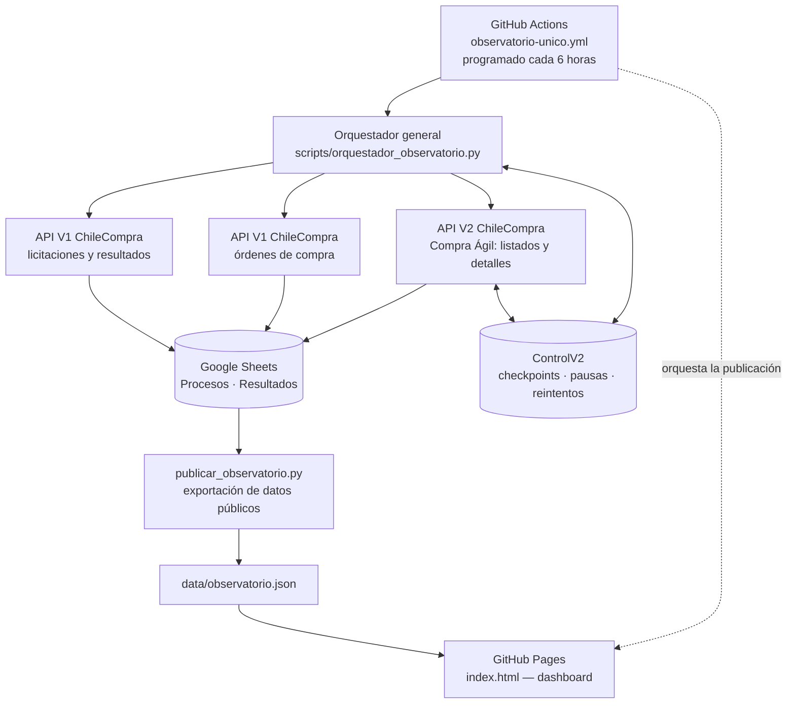

# Observatorio de Mercado Público

**Plataforma de inteligencia y seguimiento de compras públicas en Chile.** Integra información de licitaciones, Compra Ágil, ofertas, resultados y órdenes de compra proveniente de ChileCompra, utilizando una base operativa privada en Google Sheets y una visualización pública en GitHub Pages.

**Estado del proyecto (17 de octubre de 2026):** orquestación unificada, programada y con recuperación incremental. La extracción V1, el almacenamiento de procesos y la publicación del JSON/Pages han sido comprobados en ejecución integral; algunos detalles de Compra Ágil siguen afectados por respuestas 504/429 y **la inserción real de sus ofertas y resultados aún no está validada**. Las primeras ejecuciones automáticas recurrentes siguen sujetas a observación.

**Enlaces:** [Ver el observatorio](https://juliopez.github.io/MercadoPublico-Inteligencia/) · [Orquestación principal](https://github.com/juliopez/MercadoPublico-Inteligencia/actions/workflows/observatorio-unico.yml) · [Frontend](index.html) · [Instantánea pública](data/observatorio.json)

## Importador de históricos en Google Colab (pruebas aisladas)

[](https://colab.research.google.com/github/juliopez/MercadoPublico-Inteligencia/blob/main/colab/Importador_Historicos_ChileCompra_Colab.ipynb)

- **Notebook:** [Importador_Historicos_ChileCompra_Colab.ipynb](colab/Importador_Historicos_ChileCompra_Colab.ipynb).
- **Objetivo:** importar ZIP/CSV históricos oficiales de licitaciones y Compra Ágil únicamente a la pestaña `Procesos` de la **hoja clonada de pruebas**; no ejecuta los ETL de GitHub Actions, no consulta las API, no modifica archivos históricos ni publica el frontend.
- **Destino protegido:** identificador fijo del clon `1loeK_IM3RXHaR7CqpjUbz-TsNgOKNrV1ejq8aRC6JyE`. La base productiva queda fuera de alcance.
- **Ejecución:** abrir el enlace Colab, autenticar Google, elegir `FUENTE` (`licitaciones` o `compra_agil`), subir un ZIP/CSV y ejecutar la simulación. Inspeccionar recuentos y vista previa antes de escribir.
- **Seguridad:** `EJECUTAR_ESCRITURA=False` por defecto. Para escribir en el clon, cambiar a `True` y fijar `CONFIRMACION='AUTORIZO CARGA EN CLON'`; se crea primero una copia de respaldo en Drive. No ejecutar dos instancias simultáneas.
- **Idempotencia:** lee códigos existentes, consolida repetidos del origen por código y añade solo códigos ausentes. Una segunda ejecución del mismo archivo debe producir cero inserciones. Los registros existentes **no se actualizan**.
- **Controles:** valida las 16 cabeceras de `Procesos`, rechaza ausencia de código/nombre, produce CSV de revisión y JSON de simulación, escribe por lotes y verifica los códigos. Comprobar la correspondencia del histórico antes de autorizar escritura.
- **Limitaciones:** versión inicial para `Procesos`; no incorpora ofertas, adjudicaciones ni órdenes de compra. No se ha validado todavía con una carga real de ZIP en Colab. La publicación del front es otro proceso y requiere autorización separada.

## Arquitectura de un vistazo



**La navegación del dashboard no consulta directamente las API.** El sitio lee la instantánea pública `data/observatorio.json`, generada desde Google Sheets. Las credenciales de ChileCompra y Google permanecen en los secretos de GitHub; **no** se publican en el JSON ni en el frontend.

## Cómo funciona

1. **Programación y coordinación.** El único workflow periódico, [`observatorio-unico.yml`](.github/workflows/observatorio-unico.yml), está configurado mediante GitHub Actions cada seis horas. GitHub puede iniciar un cron con retraso. También admite ejecución manual.
2. **Extracción incremental.** [`orquestador_observatorio.py`](scripts/orquestador_observatorio.py) coordina licitaciones V1, resultados V1, órdenes de compra y el ciclo V2. Se procesan fechas cerradas pendientes en Chile, sin depender de que la ejecución empiece a una hora exacta. Compra Ágil V2 usa **10 registros por página** y el total de páginas informado por la API para cada fecha.
3. **Persistencia.** Los ETL insertan o actualizan datos en las hojas privadas `Procesos`, `Ofertas`, `Resultados` y `OrdenesCompra`. La hoja `ControlV2` registra progreso, errores y reintentos. Las escrituras válidas se conservan aunque una consulta posterior falle.
4. **Exportación pública.** [`publicar_observatorio.py`](scripts/publicar_observatorio.py) extrae únicamente los campos autorizados de Sheets y construye [`data/observatorio.json`](data/observatorio.json).
5. **Publicación.** El workflow confirma el JSON actualizado en el repositorio y despliega el sitio en GitHub Pages. Si alguna API queda pendiente, el dashboard puede publicar los **datos válidos ya consolidados**, sin presentar la carga parcial como cobertura completa.

## Qué ocurre cuando falla una API

| Situación | Acción operativa |
|---|---|
| Consulta válida | Escribir datos en Sheets y registrar avance |
| HTTP 504 u otro error transitorio | Registrar el error, conservar avances y diferir el reintento |
| HTTP 429 (límite de consultas) | Suspender las nuevas consultas V1/V2 durante el ciclo y guardar una **pausa persistente compartida de una hora** en `ControlV2` |
| Nueva ejecución con pausa vigente | Omitir nuevas consultas hasta el vencimiento del bloqueo |
| Extracción parcial o aplazada | Exportar y publicar los datos disponibles; mantener pendientes para ciclos posteriores |

El mecanismo combina **checkpoints**, control de frecuencia, pausas persistentes y un *circuit breaker* para V2. Está diseñado para tolerar respuestas recurrentes de error **sin perder registros ya guardados**. Esto no garantiza que la API entregue todos los detalles: una respuesta 504 puede dejar ofertas y resultados pendientes de recuperación.

## Componentes de producción

| Componente | Archivo | Propósito |
|---|---|---|
| Orquestación completa | [`observatorio-unico.yml`](.github/workflows/observatorio-unico.yml) | Programación, extracción, exportación y despliegue |
| Coordinación V1/V2 | [`orquestador_observatorio.py`](scripts/orquestador_observatorio.py) | Secuencia única y checkpoints por componente |
| Licitaciones V1 | [`sync_chilecompra_sheets.py`](scripts/sync_chilecompra_sheets.py) | Listados de licitaciones por fecha |
| Resultados V1 | [`sync_resultados_licitaciones.py`](scripts/sync_resultados_licitaciones.py) | Adjudicaciones verificables disponibles |
| Órdenes de compra | [`sync_ordenes_compra_sheets.py`](scripts/sync_ordenes_compra_sheets.py) | Órdenes de compra publicadas |
| Ciclo Compra Ágil V2 | [`v2_ciclo_github.py`](scripts/v2_ciclo_github.py) | Selección de fecha, página y detalle pendientes |
| Listados y detalles V2 | [`v2_primera_escritura_sheets.py`](scripts/v2_primera_escritura_sheets.py), [`v2_detalle_sheets.py`](scripts/v2_detalle_sheets.py) | Escritura incremental en Sheets |
| Control y solicitudes | [`v2_global_control.py`](scripts/v2_global_control.py), [`api_retry.py`](scripts/api_retry.py) | Suspensiones, frecuencia y tratamiento de errores |
| Publicación | [`publicar_observatorio.py`](scripts/publicar_observatorio.py) | JSON público con campos seleccionados |

El repositorio conserva además [`etl-loba-puntual.yml`](.github/workflows/etl-loba-puntual.yml) para consultas manuales LoBa **sin programación recurrente**. Los scripts auxiliares especializados no participan en la cadena periódica.

## Carga histórica oficial a Google Sheets

La carga masiva de históricos es **independiente de los ETL de API V1/V2**: permite incorporar archivos descargados desde [Datos Abiertos de ChileCompra](https://datos-abiertos.chilecompra.cl/descargas) directamente al libro privado [Observatorio Mercado Público — Base de Datos](https://docs.google.com/spreadsheets/d/1y81QaPy37APkBwxlYrKyE66_1ECdhL87GyWNitTfHr4/edit). No requiere volver a consultar las API ni ejecutar un ETL automático. **No confundir la carga en Sheets con la publicación del frontend**; esta última requiere una exportación posterior del JSON público y su despliegue.

### Procedimiento reproducible de incorporación

1. **Seleccionar fuente y período.** Descargar el histórico oficial en ZIP/CSV identificando tipo (licitaciones, Compra Ágil u órdenes de compra), año y mes. No mezclar categorías ni asumir que todos los registros del archivo corresponden a procesos distintos.
2. **Inspeccionar estructura y granularidad.** Identificar columnas, codificación, número de filas y clave de cada entidad. Los históricos pueden contener múltiples filas por proceso (por artículos, cotizaciones u otro detalle). **Consolidar por código del proceso solamente para la hoja `Procesos`**, con un criterio determinístico para escoger/consolidar atributos; preservar la información de detalle en su modelo correspondiente cuando se decida importar ofertas o resultados. No sumar montos de líneas heterogéneas sin validar su significado.
3. **Normalizar al contrato de destino.** Para `Procesos`, respetar exactamente las **16 columnas y su orden**: `codigo`, `nombre`, `estado`, `convocatoria`, `fecha_publicacion`, `fecha_cierre`, `monto_disponible_clp`, `organismo_comprador`, `region`, `total_ofertas_recibidas`, `motivo_seleccion`, `url_detalle`, `fecha_sincronizacion`, `categoria`, `subcategoria`, `modalidad`. Usar fechas normalizadas (AAAA-MM-DD cuando la fuente lo permita), montos numéricos sin símbolos de moneda y códigos conservados literalmente. Las columnas sin información verificable se dejan vacías; no inventar adjudicaciones, ofertas, proveedores, URLs o categorías. Identificar `modalidad` como Compra Ágil o Licitación según proceda.
4. **Leer estado real del libro antes de modificarlo.** Confirmar encabezados de `Procesos`, última fila ocupada y conjunto de códigos ya registrados. Comparar los códigos del histórico con los existentes, no solo con los del mismo mes; el histórico puede incluir procesos publicados antes y modificados posteriormente. Mantener el criterio **insertar únicamente códigos nuevos**, sin sobreescribir registros existentes. Investigar claves vacías o inconsistentes antes de cargar.
5. **Crear respaldo íntegro** del libro operativo de Google Sheets **antes de escribir**, conservando un enlace identificable con fecha y período; no confundir este respaldo con una hoja auxiliar.
6. **Preparar y validar una hoja auxiliar o CSV** con los registros nuevos, la misma cabecera de 16 campos y unicidad por `codigo`. Comprobar recuentos: filas originales, códigos únicos, códigos ya presentes y registros nuevos. La diferencia entre filas originales y procesos únicos se documenta como filas de detalle/repeticiones, no como procesos perdidos.
7. **Insertar al final de `Procesos` por bloques**, respetando el orden de columnas. En las cargas realizadas se usó el conector de Google Sheets, lectura de rangos, comparación de códigos y escritura `pasteData` por lotes; ante un bloqueo, comprobar la última fila escrita y **reanudar desde el primer bloque no confirmado**, sin repetir los lotes ya incorporados. Evitar sobrescribir encabezados o filas previas. No tocar `Ofertas`, `Resultados`, `OrdenesCompra`, controles, ETL ni cron cuando el alcance autorizado sea solo `Procesos`.
8. **Validar inmediatamente en destino.** Contar códigos no vacíos, códigos distintos y duplicados; verificar que `total_final = total_inicial + nuevos`, que todos los códigos del lote estén representados y que ninguna fila previa se haya reemplazado. Hacer muestreos de fechas, montos, modalidad y campos extensos. Informar respaldo, total final y cualquier pendiente.
9. **Publicar por separado cuando se autorice.** Una carga exitosa en Sheets **no actualiza automáticamente** `data/observatorio.json` ni GitHub Pages. Ejecutar la exportación desde Sheets y el despliegue **sin volver a extraer datos de las API** cuando el propósito sea exclusivamente reflejar lo ya cargado. Verificar contadores y filtros del dashboard después de publicar.

### Registro de cargas verificadas — septiembre de 2026

| Fuente | Filas originales | Procesos únicos en histórico | Ya presentes | Incorporados | Total final de `Procesos` |
| --- | ---: | ---: | ---: | ---: | ---: |
| Licitaciones (septiembre) | 6.917 procesos | 6.917 | 692 | 6.225 | 8.860 |
| Compra Ágil (septiembre) | 1.133.812 filas | 72.459 | 0 | 72.459 | **81.319** |

- En la primera carga había **2.635** procesos. Se importaron 6.225 nuevos tras identificar 692 existentes: **8.860**, sin duplicados.
- Para Compra Ágil se consolidaron **1.133.812 filas de detalle** en **72.459 códigos únicos** (1.061.353 filas adicionales respecto del grano proceso). Se conservó el conjunto previo de 8.860 códigos y se anexaron los 72.459 nuevos.
- **Validación final de `Procesos`: 81.319 filas con código, 81.319 códigos distintos, 0 códigos duplicados y 0 códigos vacíos.**
- [Respaldo previo a Compra Ágil](https://docs.google.com/spreadsheets/d/1na9IhA-g4GG5iH4QpujJ0r81Jl1uV8w9ehcWKpe_RSo/edit) · [Hoja auxiliar depurada de Compra Ágil](https://docs.google.com/spreadsheets/d/149_YB64BfW22rKnfAkrNxrUB8dQVV4GS3YK7lGIs1Z8/edit).
- **Alcance:** únicamente procesos. `Ofertas` y `Resultados` históricos permanecen pendientes de una carga y validación propias; el número de procesos no acredita cobertura de adjudicaciones ni de órdenes de compra.

**Regla temporal importante:** el mes del archivo histórico no equivale necesariamente al mes de publicación o adjudicación de cada proceso. Una licitación publicada en julio puede cambiar de estado en octubre. Por ello la deduplicación debe ser por **código de proceso**, y la actualización histórica de estados existentes requiere un procedimiento separado, auditable y explícitamente autorizado.

---

## Estado de validación y limitaciones conocidas

- **Comprobado:** recuperación de listados V1, cargas incrementales de páginas V2 a `Procesos`, almacenamiento de checkpoints, manejo observado de HTTP 504/429 y publicación desde Google Sheets hasta GitHub Pages.
- **Pendiente de confirmar en operación sostenida:** varias ejecuciones programadas consecutivas y recuperación posterior a bloqueos globales.
- **Pendiente de validar con datos reales:** escrituras efectivas de ofertas y selecciones V2 en `Ofertas` y `Resultados` cuando ChileCompra entregue detalles disponibles.
- **Mantenimiento:** no se ha reconstruido una suite de regresión específica para la nueva arquitectura productiva con Google Sheets.

Para investigar una incidencia, consultar primero los [registros del workflow principal](https://github.com/juliopez/MercadoPublico-Inteligencia/actions/workflows/observatorio-unico.yml) y luego `ControlV2`. No es necesario repetir manualmente consultas que ya estén sujetas a una espera registrada.

---

## Historial técnico y decisiones de desarrollo

**Las secciones siguientes son el registro histórico acumulado de la construcción del observatorio.** Incluyen decisiones y configuraciones **anteriores que ya fueron reemplazadas**, como la marcha blanca manual, cron desactivado, pruebas SQLite y múltiples workflows experimentales. **Para conocer el funcionamiento vigente, utilizar las secciones anteriores.** Se mantiene este material íntegro como trazabilidad de pruebas, cambios, errores y soluciones.

<details>
<summary><strong>Consultar historial técnico completo (documentación original)</strong></summary>

# Observatorio de Mercado Público — Estado y operación de marcha blanca

**Corte documental:** 16 de octubre de 2026. **Estado:** desarrollo operativo en validación; no se considera producción.  
**Repositorio:** [MercadoPublico-Inteligencia](https://github.com/juliopez/MercadoPublico-Inteligencia).

## 1. Objetivo y arquitectura

El observatorio permite consultar procesos de licitación, Compra Ágil, ofertas, resultados y órdenes de compra con información oficial de ChileCompra.

```text
ChileCompra API V1 / V2
        ↓
ETL ejecutados manualmente en GitHub Actions
        ↓
Google Sheets — fuente de datos operativa
  Procesos | Ofertas | Resultados | OrdenesCompra
        ↓ (publicación manual independiente)
scripts/publicar_observatorio.py
        ↓
data/observatorio.json
        ↓
GitHub Pages — index.html
```

**No hay cron ni actualización automática de los datos.** Abrir el frontend no consulta directamente ChileCompra ni modifica Google Sheets. No se deben publicar tokens o credenciales.

- [Base de datos de Google Sheets](https://docs.google.com/spreadsheets/d/1y81QaPy37APkBwxlYrKyE66_1ECdhL87GyWNitTfHr4/edit)
- [Workflow de operaciones manuales](../../actions/workflows/marcha-blanca-manual.yml)
- [Workflow de despliegue del frontend](../../actions/workflows/pages.yml)

## 2. Decisiones vigentes de la marcha blanca

1. El operador **ejecuta manualmente** cada proceso y elige la fecha `AAAA-MM-DD`. Sin fecha o con fecha futura/inexistente, no comienza la extracción.
2. Se recomienda ejecutar primero **Licitaciones**, luego **Compra Ágil**, después **Órdenes de compra** y finalmente **Publicar**; comprobar cada ejecución antes de la siguiente.
3. El workflow contiene cinco operaciones: `licitaciones`, `compra_agil`, `ordenes_compra`, `publicar`, `completa`. La fecha es obligatoria incluso para `publicar`, aunque en esa opción **no filtra** los datos publicados.
4. Las ejecuciones del mismo workflow comparten un grupo `concurrency` y no deben ejecutarse simultáneamente. No se cancela automáticamente una ejecución anterior.
5. El orquestador tiene **hasta tres intentos por componente**, separados por 45 segundos si falla. Dentro del workflow, `API_MAX_ATTEMPTS=1` evita que cada consulta individual agregue otros intentos.
6. Los ETL insertan/actualizan por claves; volver a consultar una fecha no debería duplicar procesos. **Falta validar la idempotencia integral de ofertas, resultados y órdenes.**
7. `completa` publica solo cuando terminan satisfactoriamente sus etapas. Los ETL individuales **no publican** automáticamente: luego se usa `publicar`.
8. La carga histórica masiva es otro procedimiento. Se acordó comenzar con la base vacía; no se conservó un respaldo adicional de su contenido por petición del propietario.

## 3. Componentes actuales

| Componente | Archivo principal | Función | Validación |
|---|---|---|---|
| Licitaciones (procesos) | `scripts/sync_chilecompra_sheets.py` | API V1, listado por fecha, escritura en `Procesos` | Primera carga informada en log; ver §5 |
| Licitaciones (adjudicaciones) | `scripts/sync_resultados_licitaciones.py` | Consulta detalles por código y alimenta `Resultados` cuando existe información | **Incidencia HTTP 429** |
| Compra Ágil (procesos) | `scripts/sync_chilecompra_sheets.py` | API V2, listado paginado por fecha | Pendiente de prueba integral |
| Compra Ágil (cotizaciones/selecciones) | `scripts/etl_multiproceso_manual.py` | Consulta detalle de procesos registrados; escribe en `Ofertas` y `Resultados` | Pendiente de prueba integral |
| Órdenes de compra | `scripts/sync_ordenes_compra_sheets.py` | API V1, listado por fecha y detalle por código; escribe en `OrdenesCompra` | Pendiente de prueba integral |
| Publicador | `scripts/publicar_observatorio.py` | Lee cuatro hojas y genera JSON público | Publicación vacía comprobada visualmente por el propietario |
| Frontend | `index.html` | Consulta pública, filtros, detalle y vista inicial de OC | Funcional con base vacía; ayudas contextuales incorporadas |
| Operación | `.github/workflows/marcha-blanca-manual.yml` | Cinco opciones manuales | Primer caso de licitaciones en curso al momento del último reporte |
| Despliegue de sitio | `.github/workflows/pages.yml` | Publica frontend manualmente | Despliegue del estado vacío confirmado por el propietario |

**Los dos workflows anteriores son los únicos presentes en `.github/workflows/`**, tras la limpieza. Pueden permanecer scripts auxiliares de pruebas en `scripts/`; su existencia no significa que se ejecuten automáticamente.

## 4. Base de datos y contrato de campos

Libro principal: `Observatorio Mercado Público — Base de Datos`.

| Hoja | Columnas | Uso |
|---|---:|---|
| `Procesos` | 16 | Procesos de Licitación y Compra Ágil |
| `Ofertas` | 7 | Proveedores y cotizaciones/ofertas obtenidas |
| `Resultados` | 10 | Selecciones y adjudicaciones, sin confundirlas con OC verificadas |
| `OrdenesCompra` | 10 | Órdenes públicas; entidad transaccional separada |
| `Control` | Encabezados operativos | Seguimiento y auditoría |
| `Indicadores` | Encabezados operativos | Indicadores derivados |
| `Órdenes de compra agosto 2026 (resumen)` | 10 | Hoja histórica separada; vaciada durante el reinicio |

Las tres primeras hojas contienen **33 columnas en total (16 + 7 + 10)**; `OrdenesCompra` mantiene su estructura adicional. El publicador genera las colecciones `procesos`, `ofertas`, `resultados` y `ordenescompra` dentro de `data/observatorio.json`.

**Reinicio confirmado:** se vaciaron los registros de todas las hojas, conservando sus encabezados; también se reinició el JSON público. El propietario confirmó que el frontend quedó sin registros antes de ejecutar la primera carga de prueba. Este estado de referencia **ya puede cambiar** cuando se ejecutan ETL.

## 5. Primera prueba manual — 14 de octubre de 2026

**Observación parcial de GitHub Actions #1, aportada durante su ejecución; NO es un resultado final:**

- Operación: `licitaciones`; fecha de consulta: `2026-10-14`.
- Log del listado inicial: `API_V1_LICITACIONES 2026-10-14 registros 1221`.
- Log de escritura: `Sincronizados: 0 actualizados, 1221 nuevos.`
- La fase posterior `licitaciones_resultados` comenzó a consultar detalles por código, y recibió **múltiples respuestas HTTP 429 (Too Many Requests)**.
- El estado definitivo del workflow, la cantidad final de adjudicaciones cargadas y la integridad en Sheets **aún no estaban confirmados** al documentar esta observación.
- **No modificar, reiniciar ni lanzar otros ETL mientras la ejecución observada siga activa.** Esperar su resultado y después revisar los datos en Sheets.

**Diagnóstico:** consultar gran cantidad de detalles individualmente puede exceder los límites de la API. El ETL actual continúa evaluando otros códigos después de un 429 y no aplica una pausa global; por ello no se debe dar por validada esta fase.

**Corrección pendiente, sujeta a evaluación tras el fin del proceso:** tratar 429 como limitación de frecuencia, respetar `Retry-After` si existe, introducir control de ritmo y reanudación de pendientes por fecha/código, priorizar procesos que requieren actualización y no repetir masivamente consultas rechazadas. Conservar procesos previamente incorporados.

## 6. Límites conocidos y criterios de aceptación

- Las API de listado por fecha no garantizan que se recuperen **todos los cambios posteriores** de procesos antiguos. El ETL de adjudicaciones consulta además licitaciones marcadas como cerradas o adjudicadas, pero **esa cobertura todavía no está validada**.
- La API de detalle de licitaciones no garantiza todas las ofertas individuales. **No crear ofertas ni adjudicaciones ficticias**; los históricos oficiales permiten complementar información según disponibilidad.
- La selección de una cotización en Compra Ágil no es equivalente a una orden de compra o contrato comprobado.
- No está validado el comportamiento del frontend con un volumen histórico elevado; el publicador aún genera **un único JSON**.
- Los secretos se mantienen en GitHub Actions: `CHILECOMPRA_TICKET`, `GOOGLE_SERVICE_ACCOUNT_JSON`. La variable `GOOGLE_SHEET_ID` identifica la base. Nunca copiarlos a `index.html`, logs o archivos publicados.
- La marcha blanca se considerará exitosa solo al verificar por categoría las cantidades de registros, claves únicas, correspondencia entre hojas, ausencia de datos espurios y publicación correcta.

## 7. Operación y recuperación

Para procesar una fecha: [abrir Actions](../../actions/workflows/marcha-blanca-manual.yml), seleccionar `Run workflow`, elegir operación y escribir fecha. Revisar los logs hasta que finalice. Si falla una categoría, **no repetir inmediatamente un lote de consultas HTTP 429**; diagnosticar antes de reintentar.

Una vez validados los datos en Sheets, seleccionar `publicar` para generar el JSON y desplegar Pages. Si solo cambia el HTML, utilizar `pages.yml`. Una publicación manual no debe interpretarse como validación de los ETL.

**Referencia de recuperación del código:** rama `respaldo-pre-limpieza-marcha-blanca-20261016`. No se generó un respaldo nuevo de los datos de Google Sheets durante el reinicio.


## 8. Corrección transversal de control de API (16-10-2026, posterior a la primera cancelación)

**Implementación en código, pendiente de prueba operativa.** Se modificaron `api_retry.py`, los ETL de detalles de licitaciones y Compra Ágil, el ETL de órdenes de compra y el workflow manual.

- El cliente compartido usa un intervalo mínimo configurable (`API_MIN_INTERVAL_SECONDS`, predeterminado 1,5 s) entre consultas **dentro de cada proceso Python**. No representa una tasa autorizada ni garantiza que la API no limite solicitudes.
- HTTP 429 provoca una detención inmediata del lote, registra `Retry-After` si se informa y crea la señal `.api_rate_limited`. El workflow detecta esa señal y **no inicia el segundo/tercer intento ni otras categorías**. La señal es temporal dentro del runner, no contiene credenciales.
- En `Control!M:P` se registran checkpoints de detalle de licitaciones; en `Control!Q:T`, checkpoints de detalle de Compra Ágil; y en `Control!U:X`, checkpoints de órdenes de compra. Se emplean registros por fecha y código para evitar repetir los ítems completados en una reejecución manual.
- El complemento de licitaciones persiste cada adjudicación antes de anotar su checkpoint; el detalle de Compra Ágil guarda los avances del lote procesado; las órdenes de compra guardan los datos recuperados antes de informar un corte por 429.
- Los errores distintos de 429 aún requieren inspección de logs y, si corresponde, ejecución manual con la misma fecha; los checkpoints no garantizan que un proceso previamente consultado nunca cambie de estado en el futuro.
- **Atención:** los límites concretos de ambas API son desconocidos. No se han ejecutado pruebas de carga posteriores a este cambio y no corresponde considerar validadas aún la cobertura completa, la integración del flujo ni la actualización de estados futuros.


## 9. Revisión de adjudicaciones incompletas tras la tercera ejecución

La ejecución manual n.º 3 se detuvo correctamente ante HTTP 429. Antes de detenerse dejó dos filas en `Resultados` con fecha, pero sin proveedor ni monto. Estas filas **no deben considerarse adjudicaciones confirmadas**.

La versión corregida de `sync_resultados_licitaciones.py` exige proveedor y monto explícitos antes de insertar un nuevo resultado, registra `pendiente_datos` cuando falta alguno de los dos y no interpreta checkpoints antiguos `completo` como suficientes si no existe un resultado con ambos campos. Una reejecución de la misma fecha puede consultar esos códigos pendientes, y una fecha posterior permite revisar adjudicaciones ya registradas. **Esto no significa que la API entregue siempre el proveedor o el monto:** cuando no los entrega se preserva la incertidumbre.

**Pendiente operativo:** revisar las dos filas incompletas ya existentes en `Resultados` (`1017312-6-LR26`, `1030-20-LE26`); esta corrección de código no las borró ni las convirtió en resultados confirmados. No se activó workflow ni se realizaron consultas adicionales a ChileCompra.


## 10. Auditoría transversal de dependencias — ejecución Compra Ágil n.º 4

La ejecución n.º 4 (`compra_agil`, fecha `2026-10-14`) terminó con tres errores **HTTP 504** en la consulta paginada inicial de API V2. No obtuvo procesos de Compra Ágil. Se detectó que el workflow lanzaba aun así `compra_agil_detalle`, que terminó sin procesos.

**Corrección implementada:** cada llamada a `run_etl` en `.github/workflows/marcha-blanca-manual.yml` termina inmediatamente el paso con error si el componente falla después de sus intentos. De este modo:

- Si falla el listado de **Licitaciones**, no se ejecutan sus adjudicaciones.
- Si falla el listado de **Compra Ágil**, no se consultan cotizaciones.
- Si falla cualquier etapa de `completa`, no se inicia la categoría siguiente ni se publica el JSON.
- Si una categoría individual falla, el flujo finaliza en error, conservando los datos ya escritos en Sheets.
- El bloqueo inmediato ante **HTTP 429** sigue vigente; los errores HTTP **502/503/504** mantienen hasta tres intentos **totales por componente en el workflow** con pausas de 45 segundos. Un HTTP 504 no demuestra por sí mismo que el formato de la consulta sea inválido.

**Validación pendiente:** el cambio se revisó en el código fuente, sin ejecutar todavía un workflow con ChileCompra. No se modificaron frontend ni datos de Google Sheets.


## 11. Reanudación por páginas de Compra Ágil (después de ejecución n.º 5)

La ejecución n.º 5 para `2026-10-14` informó **107 páginas** de API V2; alcanzó a descargar páginas 1 y 2 (100 registros) antes de un HTTP 504, pero la versión anterior descartó ese trabajo al fallar la siguiente página.

La nueva versión de `sync_chilecompra_sheets.py` guarda **cada página validada directamente en `Procesos`** y solo después registra el checkpoint en las columnas **A:B de `Control`**, con clave `compra_agil_page:AAAA-MM-DD:N` y valor de total de páginas. Una interrupción antes del checkpoint implica repetir esa página mediante escritura idempotente; no elimina registros guardados. Una nueva ejecución con la misma fecha **omite las páginas confirmadas**, verifica que el total de páginas no haya cambiado y continúa con las siguientes.

**Criterio de finalización:** solo después de recorrer todas las páginas (o reconocer su checkpoint) se informa `COMPRA_AGIL_LISTADO_COMPLETO` y se habilita la etapa de cotizaciones en el workflow. Si hay HTTP 504, los registros de páginas ya confirmadas permanecen en Google Sheets y el workflow no llama al ETL de detalle.

**Advertencias:** las páginas de una API paginada pueden variar si cambia el orden o se agregan registros mientras se consulta. El mecanismo verifica la cantidad de páginas, pero **no garantiza una fotografía transaccional del origen**. Los checkpoints de páginas son marcas de una fecha y no sustituyen la actualización futura de procesos. El cambio está implementado en código y **pendiente de prueba operativa**, sin ejecutarse consultas reales adicionales durante su implementación.


## 12. Auditoría preventiva transversal de las cinco opciones (16-10-2026)

Revisión estática del código, **sin ejecutar las API ni modificar las hojas**:

- **Licitaciones:** listado V1 como una sola respuesta validada; los detalles se guardan por código. Se corrigió el tratamiento de HTTP 502/503/504 y fallas de conexión en el complemento: ahora detiene la fase para permitir un reintento controlado, en lugar de seguir recorriendo todos los códigos ante una indisponibilidad.
- **Compra Ágil:** el listado V2 guarda páginas confirmadas en `Procesos` y su checkpoint en `Control!A:B`; la fase de detalles solo empieza si concluye el listado. Se corrigió además una referencia a variable incorrecta al conservar resultados verificados (`field_idx`).
- **Órdenes de compra:** si la descarga de un detalle produce HTTP 429 o un error transitorio HTTP 502/503/504, de conexión o de tiempo de espera, conserva en `OrdenesCompra` los ítems ya preparados antes de finalizar con error y deja checkpoints en `Control!U:X`. En la siguiente ejecución se omiten los códigos confirmados.
- **Publicar:** lee de Sheets sin llamar a ChileCompra. No depende de extracciones de ese mismo día cuando se elige expresamente `publicar`.
- **Completa:** hereda la condición de fallo temprano del workflow: no empieza otra categoría ni publica tras el error de la anterior.

**Riesgos remanentes:** cada proceso Python tiene su propio control de ritmo; no hay un límite oficialmente confirmado para las API. Las páginas V2 pueden variar si cambia el conjunto de origen. El listado V1 debe recibirse completo antes de guardarlo, por diseño. Los checkpoints de detalles no garantizan que una entidad no cambie después de procesada. Esta auditoría no sustituye pruebas de integración y reconciliación de registros.

**Validación:** cambios confirmados en GitHub; no ejecutados contra las API. Conservar esta distinción antes de declarar exitosa la marcha blanca.


## 13. Revisión documental de API V2 (tras ejecución n.º 6)

Se contrastó la integración con el [portal oficial de ChileCompra](https://www.chilecompra.cl/api/) y referencias técnicas de la guía API Compra Ágil V2. El endpoint `GET /v2/compra-agil`, filtros `publicado_desde` y `publicado_hasta` y cabecera `ticket` coinciden con la interfaz descrita; los errores **HTTP 504** de las ejecuciones n.º 4, 5 y 6 no demuestran que el endpoint o el ticket sean incorrectos.

**Cambio puntual:** se incorporó zona horaria explícita `America/Santiago` en los parámetros ISO 8601 de la ventana diaria, respetando el día civil chileno elegido por el operador. No se redujo el universo de registros ni se activaron particiones horarias porque todavía no se ha validado en documentación oficial la estabilidad de la paginación entre consultas particionadas.

**Pendiente:** validar el formato de fecha y la disponibilidad real del servicio en una próxima ejecución manual, sin efectuar pruebas masivas innecesarias. No se modificaron las hojas ni los ETL de Licitaciones u Órdenes de compra.


## 14. Campo manual de rubro/categoría en Compra Ágil

El formulario de `Marcha blanca - operaciones manuales` ahora ofrece `categoria_compra_agil` como **texto libre opcional** junto con operación y fecha. Solo se permite para `compra_agil`; el ETL incorpora el texto en el parámetro de búsqueda `q` de API V2. Si se deja vacío, mantiene la consulta por fecha sin filtro textual.

Este campo **no es el código de una categoría oficial** y no modifica la estructura de las columnas de `Procesos`. Los checkpoints de páginas de una consulta filtrada se separan de los de una consulta sin filtro mediante una clave derivada del texto. Las consultas filtradas son pruebas de un subconjunto y **no demuestran cobertura histórica completa del día**. La fase de cotizaciones se ejecuta después de finalizar la búsqueda filtrada y utiliza los procesos de Compra Ágil presentes en Sheets para la fecha solicitada.

No se ejecutó el workflow ni se consultó la API al incorporar el formulario.


## 15. Selector de rubros en el formulario manual

Se reemplazó el campo de texto libre `categoria_compra_agil` por una **lista desplegable** (`workflow_dispatch` con `type: choice`): `Todas` (por defecto), `Capacitación`, `Computación`, `Software`, `Asesoría`, `Consultoría`, `Equipamiento`, `Mantención`, `Servicios` e `Insumos médicos`. El valor `Todas` equivale a una búsqueda sin el parámetro textual `q`. Los demás valores se envían literalmente como palabras clave de búsqueda.

**No son categorías oficiales exhaustivas de ChileCompra** ni códigos UNSPSC: son temáticas orientativas para pruebas de alcance acotado. La lista puede revisarse posteriormente en función de las categorías oficiales disponibles. El control de fecha sigue siendo obligatorio y no se modificaron los registros existentes.


## 16. Evidencia empírica API V2 Compra Ágil — Ubuntu, 17-10-2026

**Propósito:** conservar evidencia reproducible sobre los problemas HTTP de la API V2 y facilitar que un futuro equipo o asistente retome el diagnóstico sin repetir consultas. **Estado:** investigación técnica; NO demuestra disponibilidad sostenida, NO equivale a integración validada con Sheets. El propietario priorizó resolver el consumo directo de API V2, sin utilizar archivos históricos en esta investigación.

### 16.1 Restricciones vigentes

- **Mantener congelados los ETL originales** y su orquestación (incluidos `scripts/sync_chilecompra_sheets.py`, `scripts/etl_multiproceso_manual.py`, `scripts/sync_resultados_licitaciones.py`, `scripts/sync_ordenes_compra_sheets.py`, `.github/workflows/marcha-blanca-manual.yml`). Los diagnósticos y el extractor aquí descritos son **independientes**.
- Ejecutar las pruebas controladas desde **Ubuntu local**; no modificar Google Sheets, `data/observatorio.json` ni `index.html` mientras no se apruebe una integración.
- **No publicar el ticket API**, las respuestas que puedan contener datos sensibles ni las credenciales. La variable local de entorno es `CHILECOMPRA_TICKET`.
- Incidente reportado a ChileCompra: **`INC-1403213-Q2T1Z9`**. Solicitud enviada exitosamente el 17-10-2026; respuesta oficial pendiente al documentar estas mediciones.

### 16.2 Endpoints y parámetros comprobados

| Operación | Endpoint | Autenticación | Estado |
|---|---|---|---|
| Listado Compra Ágil | `GET https://api2.mercadopublico.cl/v2/compra-agil` | Header `ticket` | Respuestas HTTP 200 verificadas con paginación |
| Detalle individual | `GET https://api2.mercadopublico.cl/v2/compra-agil/{codigo}` | Header `ticket` | HTTP 504 recurrente; hubo al menos una respuesta HTTP 200 previa |
| Licitación V1 (control comparativo) | `GET https://api.mercadopublico.cl/servicios/v1/publico/licitaciones.json?codigo=...&ticket=...` | Parámetro `ticket` | HTTP 200 en prueba puntual |

Parámetros del listado que devolvieron HTTP 200: `publicado_desde=2026-10-15T00:00:00-03:00`, `publicado_hasta=2026-10-15T23:59:59-03:00`, `numero_pagina=1`, `tamano_pagina=10`. **Restricción confirmada por error HTTP 400:** `tamano_pagina` debe estar **entre 10 y 50**; un intento con valor 1 fue rechazado con el mensaje `Parámetros de consulta inválidos`. El parámetro `q` es una búsqueda **textual**, no una categoría oficial.

### 16.3 Resultados observados (no son métricas SLA)

| Prueba | Resultado empírico |
|---|---|
| V1, licitación `1017312-6-LR26` | HTTP 200, **0,32 s** (diagnóstico de encabezados) |
| V2, detalle `425-339-COT26` | HTTP 200, **26,69 s** (diagnóstico de encabezados; **no se leyó el cuerpo**) |
| V2, detalle con `curl --http1.1` | HTTP 504, **29,907 s**; DNS 0,113 s, TCP 0,312 s, TLS 0,524 s; primer byte 29,907 s; mensaje de error JSON de 41 bytes |
| V2, listado con `tamano_pagina=1` | HTTP 400; el servidor exige valor entre 10 y 50 |
| V2, listado con 10 registros, página 1 | HTTP 200, **19,37 s**, 10 ítems, **496 páginas** informadas para 15-10-2026 |
| V2, listado con 50 registros sin filtro | HTTP 504 en **29,52 s**, `Endpoint request timed out` |
| V2, listado con 50 registros y `q=capacitación` | HTTP 504 en **29,72 s**, mismo mensaje |
| V2, diagnóstico 3 páginas de 10 | Tres HTTP 200: **10,70 / 8,81 / 7,16 s**; 30 ítems, 496 páginas informadas |
| V2, extractor local 3 páginas de 10 | Tres HTTP 200: **7,36 / 8,09 / 7,48 s**; tres JSON completos almacenados |
| V2, extensión a 10 páginas | Primer intento: **HTTP 500** en página 4, 11,16 s; nueva ejecución: páginas 4–10 con HTTP 200 en **8,20 / 4,30 / 5,53 / 8,61 / 12,64 / 9,78 / 7,30 s** |
| V2, detalle `425-339-COT26` | HTTP 504, **29,60 s**, `Endpoint request timed out` |
| V2, detalle `425-325-COT26` | HTTP 504, **29,71 s**, mismo mensaje |
| V2, detalle `3179-290-COT26` | HTTP 504, **29,57 s**, mismo mensaje |

**Resultado consolidado del extractor local:** **10 páginas / 100 registros / 100 códigos únicos / 0 duplicados observados**, con almacenamiento persistente en JSON y reanudación de páginas válidas sin nuevas solicitudes. La API reportó **496 páginas** para la fecha y tamaño 10: **NO** se completó la extracción de las 496 páginas. En una reejecución de las primeras tres páginas, el extractor informó explícitamente `sin consultar API`.

**Importante:** el HTTP 500 de la página 4 se resolvió en un intento posterior (fue transitorio *en ese caso*). Las tres solicitudes de detalle posteriores devolvieron HTTP 504 alrededor de 29,6 s pese a pausas de 60 s. La respuesta exitosa inicial del detalle y los fallos posteriores impiden afirmar que ese endpoint esté permanentemente caído.

### 16.4 Auditoría de los 100 JSON de listado (sin llamadas adicionales)

Se inspeccionaron los 100 registros locales. Todos tenían presentes las **claves de primer nivel**: `codigo`, `nombre`, `estado`, `convocatoria`, `documentos`, `fechas`, `institucion`, `links`, `montos`, `motivos` y `resumen`. La presencia de claves **no garantiza que sus valores sean completos**.

Subcampos observados: `resumen.total_ofertas_recibidas`, `montos.monto_disponible_clp`, `institucion.organismo_comprador`, `fechas.fecha_publicacion`, `fechas.fecha_cierre`, y `links.detalle`, entre otros. **El listado no contiene cotizaciones individuales explícitas ni precios individualizados por proveedor** en la muestra. No inferir adjudicaciones ni ofertas de participantes a partir de estos resúmenes.

Los 100 `links.detalle` inspeccionados tenían rutas relativas del patrón `/v2/compra-agil/{codigo}` (ejemplo `/v2/compra-agil/2288-708-COT26`), que corresponde al **mismo endpoint de detalle** probado. No se identificó en esos enlaces una vía alternativa para evitar HTTP 504.

Se dispone además de **un JSON de detalle exitoso** recuperado inicialmente en GitHub Actions para `425-339-COT26`, con aproximadamente **24,7 KB**, **14 cotizaciones** y **un producto solicitado**. Esa respuesta fue válida en esa ocasión y permitió observar las cotizaciones; **su tamaño pequeño no explica por sí solo los tiempos de espera**. No confundir el HTTP 200 observado mediante el diagnóstico de encabezados con una descarga JSON completa.

### 16.5 Scripts separados y dónde buscar los respaldos

Todos los siguientes scripts de diagnóstico son **experimentales** y están en `scripts/`, sin conectarse a Google Sheets:

- `diagnostico_api_v1_v2_local.py`: comparación V1/V2 por código; solo estado y tiempos, no cuerpos.
- `diagnostico_curl_v2_local.sh`: detalle V2 por `curl` HTTP/1.1, medidas de DNS/TCP/TLS/primer byte.
- `diagnostico_listado_v2_local.py`: una página del listado con tamaño 50, opcional `--q`; historial de versiones anteriores probó tamaño 10 y 1.
- `diagnostico_paginacion_v2_local.py`: hasta tres páginas de 10; registro técnico sin cuerpos.
- `extractor_v2_incremental_local.py`: extractor **local** de listado V2, actualmente con máximo **10 páginas por ejecución**, tamaño de página 10, pausa configurable (60 s usada), guardado atómico, reanudación y controles de códigos repetidos.
- `diagnostico_tres_detalles_v2_local.py`: tres códigos de detalle con pausa 60 s; detención ante HTTP 429; registra respuestas y guarda cuerpo JSON cuando HTTP 200.
- `auditar_campos_listado_v2_local.py`: inspección **offline** de claves/subclaves de listados.

**Archivos locales de Ubuntu, NO incluidos en GitHub por defecto:** `extraccion_v2_local/2026-10-15_b7e05155c31a/pagina_0001.json` hasta `pagina_0010.json`, más `manifest.json`; `diagnostico_detalles_v2/resultados.json` (tres 504); `diagnostico_paginas_v2/resultados.json` (tres 200). El artefacto de la primera consulta exitosa de detalle en Actions corresponde a la ejecución **`39047390195`**, artefacto **`12105548946`**; verificar su disponibilidad antes de usarlo, pues los artefactos expiran.

**Reanudar/validar localmente:** desde la raíz del clon Ubuntu y con `CHILECOMPRA_TICKET` configurado, ejecutar `python3 scripts/extractor_v2_incremental_local.py --fecha 2026-10-15 --max-paginas 10 --pausa 60`. Mientras existan y sean válidos los diez JSON locales, **no debe generar consultas nuevas**. No ampliar a 496 páginas sin un plan y aprobación explícita. El almacenamiento local **no se sincroniza automáticamente** con GitHub ni con Sheets.

### 16.6 Interpretación técnica y punto de continuación

**Confirmado:** conectividad y autenticación operan; el listado V2 puede recuperarse por páginas con interrupciones recuperables; el detalle individual presentó HTTP 504 **reproducible en tres códigos**, con un mensaje del servidor `Endpoint request timed out` y latencias cercanas a 30 s. El servicio también presentó HTTP 500 transitorio en listado y HTTP 400 por parámetro inválido.

**Hipótesis, NO causa demostrada:** existe un límite de ejecución o de pasarela cercano a 30 s. No se ha identificado si ocurre en aplicación, base de datos, balanceador u otro componente interno. No atribuir causalmente el éxito del listado a las pausas o al tamaño 10 sin pruebas comparables; las muestras son reducidas y la disponibilidad es intermitente.

**Pendiente externo:** solicitar respuesta técnica de ChileCompra al incidente **`INC-1403213-Q2T1Z9`** respecto de timeout del detalle, posible incidencia conocida y mecanismo documentado para obtener cotizaciones; complementar con los tres HTTP 504 medidos si hace falta.

**Decisión vigente del propietario:** concluir el diagnóstico de **API V2** antes de discutir relevancia para LoBa, cargas históricas, cambios en frontend o escrituras en Sheets. **No repetir indiscriminadamente consultas de detalle**; conservar los respaldos, examinar primero evidencia existente y mantener los ETL originales congelados hasta nueva autorización.


## 17. Orquestador local SQLite tolerante a fallos — prototipo 17-10-2026

**Archivo nuevo:** `scripts/orquestador_v2_sqlite_local.py`. Su implementación es un prototipo **aislado de los ETL congelados**: no escribe en Google Sheets ni modifica el frontend. No debe considerarse probado contra API hasta ejecutar la validación local y controlada.

- Usa `orquestacion_v2_local/control.sqlite3` con tablas `jobs` (estado por fecha y página) y `events` (bitácora). Archivos JSON en `orquestacion_v2_local/AAAA-MM-DD/pagina_NNNN.json`.
- `iniciar --fecha 2026-10-15 --paginas 10 --importar-local` permite incorporar los diez JSON previamente recuperados desde `extraccion_v2_local/2026-10-15_*` **sin consultar la API**.
- `estado --fecha 2026-10-15` consulta únicamente SQLite.
- `ejecutar --fecha 2026-10-15 --max-solicitudes 2 --pausa 60` consume las tareas disponibles, con un límite de 1 a 3 solicitudes por ejecución; puede reanudar sin duplicar códigos entre páginas. Solo ejecutar con autorización y ticket presente en variable de entorno.
- Respuestas 500/502/503/504 y errores de red se difieren con espera progresiva y pequeña aleatoriedad; 429 se suspende al menos una hora (o más si `Retry-After` numérico lo exige); 400/401/403 se marcan para revisión. La ejecución se detiene al primer error en lugar de insistir.
- **Pendientes antes de producción:** pruebas locales de inicialización/consulta SQLite, pruebas supervisadas de fallos, bloqueo de ejecuciones concurrentes, normalizar actualizaciones temporales y cambios de páginas, compatibilidad de `Retry-After` como fecha HTTP, circuit breaker global, cola de detalles separada, conciliación de cobertura total, persistencia fuera del equipo y políticas de actualización de registros que cambian. Un simple backoff no soluciona los HTTP 504 sistemáticos del detalle.


### 17.1 Pruebas de tolerancia a fallos sin consumir ChileCompra (17-10-2026)

Se incorporó `scripts/test_orquestador_v2_sqlite_local.py`, una batería de pruebas con **respuestas HTTP simuladas** mediante mocks de Python y un directorio/SQLite temporales. Ejecutar desde la raíz del repositorio:

```bash
python3 -m unittest discover -s scripts -p 'test_orquestador_v2_sqlite_local.py' -v
```

Casos: HTTP 200 con almacenamiento y omisión de páginas ya completadas; HTTP 500/504 con diferimiento sin pérdida del progreso; HTTP 429 con espera mínima de una hora; HTTP 400 con estado de revisión no elegible para nuevos intentos; tareas en espera no seleccionadas antes de vencer su plazo; detección de códigos duplicados entre páginas. **No se consulta la API en estas pruebas, ni se usa el ticket real.**

**Corrección preventiva:** la selección de trabajos en `orquestador_v2_sqlite_local.py` ahora considera únicamente estados `pendiente` y `espera`; una tarea `revision` no se reintenta automáticamente. Las pruebas se incorporaron a GitHub; su ejecución y resultado en Ubuntu deben verificarse antes de declarar validada la recuperación simulada.


### 17.2 Validación en Ubuntu de simulaciones (17-10-2026)

El propietario ejecutó `python3 -m unittest discover -s scripts -p 'test_orquestador_v2_sqlite_local.py' -v` desde Ubuntu. La captura de terminal muestra **`Ran 6 tests in 0.031s` y `OK`**, sin errores ni fallos. Casos cubiertos: 200 persistido, 500/504 diferidos sin perder completos, 429 suspendido, 400 para revisión sin selección automática, tarea con espera no elegible y duplicación de códigos entre páginas bloqueada. **Son pruebas con HTTP simulado; no prueban disponibilidad ni recuperación de detalles en la API real.** Próxima etapa: circuito de suspensión global y cola de detalles independiente, manteniendo congelados los ETL originales.


### 17.3 Circuit breaker compartido y cola separada de detalles (17-10-2026)

Se incorporó **circuit breaker persistente** al `scripts/orquestador_v2_sqlite_local.py`, con tabla `circuit` en la misma base SQLite. Tres fallos transitorios consecutivos (HTTP 500/502/503/504 o error de conexión) suspenden nuevas solicitudes durante 30 minutos; un HTTP 429 abre el circuito inmediatamente durante al menos una hora; respuestas HTTP 200 reinician el contador. Esta es una **política experimental del cliente, no un límite oficial**. Todas las colas que comparten el mismo archivo SQLite consultan el circuito antes de pedir datos.

Archivo nuevo `scripts/orquestador_v2_detalles_local.py`: cola independiente `detail_jobs` por código, inicializada a partir de los listados JSON **ya guardados** (`iniciar`). Permite consultar su `estado` sin consumir API; la acción `ejecutar` queda **explícita**, limitada a una solicitud por defecto y máximo dos. Los errores 500/504 quedan en espera diferida y los códigos completos se guardan individualmente. Esta es una primera versión de prototipo: todavía requiere validar que cada HTTP 200 incluya la estructura de detalle y el código solicitado, control de concurrencia y comportamiento operativo con el endpoint real.

**Pruebas offline nuevas:** `python3 -m unittest discover -s scripts -p 'test_orquestador_v2_circuito_detalles.py' -v`. Cubren activación por tres fallos consecutivos, reinicio tras éxito, activación inmediata por HTTP 429, inicialización idempotente de detalles desde archivos locales y bloqueo de solicitudes cuando el circuito está abierto. Las pruebas se incorporaron al repositorio, **pendientes de ejecución y validación en Ubuntu**. No se modifica Sheets, frontend ni ETL originales.

**Secuencia segura en Ubuntu, sin llamadas reales a ChileCompra:**
```bash
git pull origin main
python3 -m unittest discover -s scripts -p 'test_orquestador_v2_circuito_detalles.py' -v
python3 scripts/orquestador_v2_detalles_local.py iniciar --fecha 2026-10-15
python3 scripts/orquestador_v2_detalles_local.py estado
```
No ejecutar todavía `orquestador_v2_detalles_local.py ejecutar` hasta validar las pruebas y acordar una prueba real puntual.


### 17.4 Validación offline confirmada en Ubuntu (17-10-2026)

El propietario ejecutó la batería `test_orquestador_v2_circuito_detalles.py` y la terminal confirmó **`Ran 5 tests in 0.007s` / `OK`**. Sumadas las seis pruebas anteriores, existen **11 simulaciones aprobadas**. También ejecutó `orquestador_v2_detalles_local.py iniciar --fecha 2026-10-15` y `estado`: ambos informaron **`{"pendiente": 100}`**, sin consultas HTTP reales. Los 100 procesos del listado quedan como trabajos pendientes de detalle en SQLite.

**Limitación prioritaria antes de efectuar pruebas reales del detalle:** el prototipo actual considera suficiente que HTTP 200 devuelva un objeto JSON, pero todavía debe comprobar el contrato real de detalle y la correspondencia del código solicitado. No declarar completos los detalles hasta implementar esa validación. El circuit breaker compartido se probó con mocks; su eficacia operacional requiere verificación controlada. No modificar ETL originales ni Google Sheets.


### 17.5 Validación del JSON de detalle antes de marcar completo (17-10-2026)

Se corrigió `scripts/orquestador_v2_detalles_local.py`: una respuesta HTTP 200 **no basta** para confirmar un detalle. La función `validar_detalle(raw,codigo)` exige `success=OK` (o `true`), `errors` vacío, `payload` con código idéntico al solicitado y las estructuras `institucion` (objeto), `proveedores_cotizando` (lista) y `productos_solicitados` (lista). Esta estructura fue contrastada con el JSON real de `425-339-COT26` recuperado previamente por GitHub Actions. Si la validación falla, el detalle no se marca `completo` y se conserva para reintento. **Pendiente:** establecer verificaciones semánticas más profundas de cotizaciones/adjudicaciones.

Pruebas nuevas sin red: `python3 -m unittest discover -s scripts -p 'test_validacion_detalle_v2.py' -v` (seis casos: válido, código ajeno, éxito falso, errores encapsulados, payload ausente, lista de cotizaciones ausente). Deben ejecutarse primero en Ubuntu y verificar `OK`; no ejecutar todavía llamadas reales hasta esa validación.

### 17.6 Validación offline confirmada en Ubuntu (17-10-2026)

La captura del propietario muestra **6/6 pruebas de validación de detalle aprobadas** (`Ran 6 tests in 0.001s`, `OK`). Total acumulado: **17/17 simulaciones aprobadas** (6 persistencia, 5 circuito/cola, 6 contrato JSON). Se verificó además el contrato contra el artefacto JSON exitoso de GitHub Actions del proceso `425-339-COT26`: contiene `success`, `payload.codigo`, `payload.institucion`, `payload.productos_solicitados` y `payload.proveedores_cotizando`. Esto no demuestra disponibilidad del endpoint real; la siguiente etapa es **una sola consulta real supervisada**, mediante `python3 scripts/orquestador_v2_detalles_local.py ejecutar --max-solicitudes 1` desde Ubuntu, con ticket configurado. Inspeccionar luego `estado` y no repetir manualmente sin revisar resultado. Los ETL originales continúan congelados.

### 17.7 Primera consulta REAL de detalle V2 mediante orquestador (17-10-2026)

El propietario ejecutó en Ubuntu `python3 scripts/orquestador_v2_detalles_local.py ejecutar --max-solicitudes 1`. **Resultado comprobado en captura:** `1057491-1883-COT26: HTTP 200, 12.41 s, completo`; posteriormente `estado` devolvió **`{"completo": 1, "pendiente": 99}`** y el circuit breaker **`consecutivos: 0`, `abierto_hasta: ''`**. El script valida estructura/código y escribe el JSON antes de registrar el estado completo. Se trata de **una sola consulta real exitosa**, no de evidencia de estabilidad sostenida ni de recuperación de los 99 restantes. Los ETL originales y Google Sheets permanecieron intactos. Próximo paso recomendado: inspección offline del archivo de detalle recuperado, integridad del registro SQLite y eventos, antes de ampliar las consultas.

### 17.8 Integridad comprobada del primer detalle real (17-10-2026)

Auditoría offline del código **`1057491-1883-COT26`** efectuada en Ubuntu: estado SQLite `completo`, HTTP `200`, `intentos=1`, archivo JSON presente, **2.585 bytes**, `payload.codigo` coincidente, `proveedores_cotizando` **0**, `productos_solicitados` **1**, comprobación `Integridad: CORRECTA`. La integridad **no implica** que haya cotizaciones individuales disponibles; una lista vacía es estructura válida. Quedan 99 detalles pendientes. Evidencia de **un ciclo real** solicitud → validación → persistencia; no de disponibilidad sostenida de detalle. El siguiente ensayo debe ser limitado y supervisado, no una descarga masiva.

### 17.9 Dos detalles reales adicionales recuperados (17-10-2026)

Prueba Ubuntu `orquestador_v2_detalles_local.py ejecutar --max-solicitudes 2`: **`1057491-1884-COT26` HTTP 200 en 3,47 s** y **`1057491-1885-COT26` HTTP 200 en 15,97 s**, ambos marcados `completo`. Estado posterior de la cola: **3 completos, 97 pendientes**; circuit breaker `consecutivos=0`, `abierto_hasta=''`. Junto con `1057491-1883-COT26` se han recuperado **3 detalles reales** desde la API V2 mediante el orquestador. Continúa pendiente validar un fallo real y aplicar limitación de frecuencia global entre colas/solicitudes; el prototipo actual puede ejecutar detalles consecutivos sin una pausa explícita. No declarar estabilidad general con tres éxitos.

### 17.10 Limitador global de frecuencia V2 (17-10-2026)

Se añadió a `scripts/orquestador_v2_sqlite_local.py` una tabla SQLite `rate_limit` y la función `reserve_request()`. Cada llamada de listado y cada llamada de detalle solicita un turno mediante `BEGIN IMMEDIATE`, reserva el siguiente instante disponible y **espera fuera de la transacción**. La política experimental inicial es **60 segundos entre inicios de solicitudes** de las dos colas, compartiendo `orquestacion_v2_local/control.sqlite3`. No implica un límite oficial de ChileCompra y no soluciona por sí solo la intermitencia HTTP 504. El circuito de suspensión se mantiene como control separado.

Pruebas offline incorporadas: `scripts/test_orquestador_v2_frecuencia.py`, cuatro casos para primera reserva, segunda cola, tres reservas consecutivas y persistencia tras reabrir SQLite. Ejecutar: `python3 -m unittest discover -s scripts -p 'test_orquestador_v2_frecuencia.py' -v`. **Pendiente comprobar OK en Ubuntu; no ejecutar consultas reales mientras se valida**. La función `--pausa` del prototipo de listado se conserva por compatibilidad, pero el intervalo compartido se fija en 60 segundos, independientemente de ese argumento. Falta implementar coordinación multiproceso estricta sobre la duración de toda la solicitud y robustez ante terminación durante la espera antes de uso en producción.

### 17.11 Validación Ubuntu del limitador global (17-10-2026)

Capturas del propietario: `test_orquestador_v2_frecuencia.py` terminó **4/4 (`Ran 4 tests in 0.005s`, `OK`)**; la batería de regresión `test_orquestador_v2*.py` terminó **15/15 (`Ran 15 tests in 0.025s`, `OK`)**. Las pruebas usaron SQLite y respuestas simuladas, **sin consumo real de ChileCompra**. El límite experimental compartido entre listado y detalle se mantiene en 60 segundos entre reservas de solicitudes. Pendiente: coordinación estricta de solicitudes simultáneas y recuperación de una reserva en proceso ante interrupciones; no declarar todavía automatización desatendida de producción.

### 17.12 Exclusión mutua entre listados y detalles (17-10-2026)

Los dos ejecutables locales incorporaron un **bloqueo exclusivo de archivo POSIX (`fcntl.flock`)** compartido en `orquestacion_v2_local/api_v2_ejecucion.lock`. Se adquiere al iniciar la operación explícita `ejecutar` y se mantiene durante **toda la ejecución**, incluido el consumo HTTP y las esperas. Si existe otra ejecución en curso, la nueva finaliza con un error claro **sin generar solicitudes**. En Ubuntu, el sistema operativo libera el bloqueo al finalizar el proceso, incluso por interrupción o cierre inesperado; el archivo `.lock` puede permanecer en disco sin significar que el recurso siga bloqueado. El control protege únicamente ejecuciones de estos dos programas en el mismo equipo y sobre la misma carpeta: **no coordina distintas computadoras ni acciones GitHub**.

Se añadió `scripts/test_orquestador_v2_exclusion.py` para simular segundo ejecutor bloqueado, liberación ante excepción e interrupción y conservación del estado SQLite. Validación pendiente en Ubuntu:
```bash
git pull origin main
python3 -m unittest discover -s scripts -p 'test_orquestador_v2_exclusion.py' -v
python3 -m unittest discover -s scripts -p 'test_orquestador_v2*.py' -v
```
Ambos comandos **no consumen ChileCompra**. Siguiente etapa tras aprobar: probar una interrupción controlada sin API y revisar consistencia de tareas; los ETL originales continúan congelados.

### 17.13 Pruebas de exclusión mutua superadas en Ubuntu (17-10-2026)

El propietario ejecutó las cuatro pruebas específicas de exclusión mutua con resultado **`Ran 4 tests in 0.003s / OK`**. La regresión con patrón `test_orquestador_v2*.py` terminó **`Ran 19 tests in 0.025s / OK`**. Fueron simulaciones locales sin solicitudes a ChileCompra. Se verificaron segunda ejecución bloqueada, liberación del bloqueo tras excepción o KeyboardInterrupt y persistencia SQLite. Próxima validación: interrupción de tarea durante la recuperación y coherencia entre archivo JSON y checkpoint; no alterar ETL originales ni Sheets.


### 17.14 Reconciliación después de una interrupción JSON → SQLite (17-10-2026)

Se incorporó recuperación **offline antes de volver a consultar la API** en las dos colas:

- `orquestador_v2_sqlite_local.py`: `reconcile_pages` examina páginas JSON persistidas cuyo checkpoint aún no figura como `completo`; comprueba estructura, recuento, código único y consistencia con páginas confirmadas, luego registra el checkpoint y evento `recuperado_desde_archivo` sin consumir HTTP.
- `orquestador_v2_detalles_local.py`: `reconcile_details` comprueba que el JSON local coincida con el código de la cola y, si es válido, lo marca `completo` sin repetir la solicitud.
- Los JSON existentes nunca deben sobrescribirse para encubrir una inconsistencia. Ante archivo inválido, la reconciliación se detiene para revisión, sin confirmar falsamente.
- `scripts/test_orquestador_v2_recuperacion.py` incluye **seis casos offline**: interrupción antes del archivo, después de escribir página sin checkpoint, después del checkpoint, detalle guardado sin checkpoint, detalle aún no guardado y JSON inválido.

Ejecutar desde Ubuntu `python3 -m unittest discover -s scripts -p 'test_orquestador_v2_recuperacion.py' -v` y luego `python3 -m unittest discover -s scripts -p 'test_orquestador_v2*.py' -v`. **Pendiente resultado de pruebas**. No se consultó ChileCompra, no se modificaron los ETL congelados ni Google Sheets. Esta reconciliación soluciona el intervalo de fallo entre escritura atómica del archivo y actualización SQLite, pero no equivale todavía a garantía transaccional de extremo a extremo frente a todo tipo de pérdida de disco.

### 17.15 Corrección de regresión de reconciliación (17-10-2026)

La captura de Ubuntu confirmó **6/6 pruebas nuevas de recuperación aprobadas**, pero **6 fallos en la regresión de 25 pruebas**. La causa fue el argumento `root=ROOT` de las funciones de reconciliación: Python capturaba la ruta real al definir la función, por lo que las pruebas temporales podían recuperar por error JSON persistidos en el directorio productivo local. Se corrigieron `reconcile_pages` y `reconcile_details` para resolver el directorio **en tiempo de ejecución** (`root=None` y lectura de `ROOT` en el cuerpo). El cambio separa pruebas temporales de archivos reales y mantiene recuperación sin HTTP. **Pendiente:** volver a ejecutar ambas baterías en Ubuntu y verificar resultado `OK`; no afirmar validación integral mientras no ocurra. Sin modificación de ETL originales ni Google Sheets.

### 17.16 Regresión recuperada tras corrección de rutas (17-10-2026)

El propietario volvió a ejecutar en Ubuntu la batería `python3 -m unittest discover -s scripts -p 'test_orquestador_v2*.py' -v`: **`Ran 25 tests in 0.032s` / `OK`**. La corrección de resolución de rutas en tiempo de ejecución eliminó los seis fallos previos y la regresión completa ahora aprueba. Los HTTP 500/504 visibles fueron **simulaciones**, no nuevas solicitudes reales. Próximo objetivo: prueba supervisada de reanudación con archivos y SQLite locales, sin alterar trabajos reales y sin consultar ChileCompra. ETL originales y Sheets siguen congelados.

### 17.17 Ensayo aislado de recuperación contra copia temporal (17-10-2026)

Nuevo script `scripts/ensayo_recuperacion_copia_local.py`, **pendiente de ejecutar en Ubuntu**. Realiza backup consistente de la base `orquestacion_v2_local/control.sqlite3` mediante SQLite Backup API a una carpeta temporal, copia los JSON de las páginas completas y un detalle completo, simula un checkpoint perdido **solo en la copia**, ejecuta reconciliación y comprueba recuperación sin peticiones HTTP y bytes de los originales intactos. El directorio temporal se elimina al finalizar. Invocación: `python3 scripts/ensayo_recuperacion_copia_local.py`. No necesita `CHILECOMPRA_TICKET`, no escribe sobre la base original, no consulta la API ni modifica ETL/Sheets. Esta validación de fallo simulado no sustituye las pruebas de interrupción real, pero verifica la recuperación sobre archivos existentes. Si falta alguno de los archivos originales, detener y diagnosticar antes de continuar.

### 17.18 Ensayo sobre copia real superado en Ubuntu (17-10-2026)

Captura del propietario al ejecutar `python3 scripts/ensayo_recuperacion_copia_local.py`: `PRUEBA AISLADA OK: página 1, fecha 2026-10-15; checkpoint recuperado sin HTTP`; `PRUEBA AISLADA OK: detalle 1057491-1883-COT26; checkpoint recuperado sin HTTP`; `Directorio temporal eliminado; originales intactos.` La batería anterior muestra además `Ran 25 tests in 0.032s` / `OK`. Se comprobó reconciliación sobre una copia de JSON y SQLite locales, **sin llamadas reales a la API**, preservando originales. Próxima fase: ensayo supervisado de operación prolongada, con umbrales de cantidad y duración, límite global de frecuencia y suspensión al primer fallo; no afirmar estabilidad ininterrumpida hasta medirla.

### 17.19 Ensayo supervisado de hasta cinco detalles V2 (17-10-2026)

`orquestador_v2_detalles_local.py` admite ahora `--max-solicitudes 1..5` y `--max-duracion 120..900` (por defecto 420 segundos). Antes de cada consulta calcula el tiempo transcurrido y la próxima espera del limitador SQLite, y **no inicia otra consulta** si el presupuesto restante es inferior a 45 segundos. Es un límite **preventivo entre solicitudes**, no una interrupción forzada de una llamada HTTP iniciada; podría excederse levemente el presupuesto por procesamiento del sistema. Mantiene pausa global de 60 s entre inicios, circuito, bloqueo exclusivo y detención ante el primer fallo. No se ejecutó el ensayo contra ChileCompra desde el asistente. Validar en Ubuntu antes de utilizarlo: `git pull origin main` y `python3 -m unittest discover -s scripts -p 'test_orquestador_v2*.py' -v`. Solo tras pruebas satisfactorias ejecutar expresamente `python3 scripts/orquestador_v2_detalles_local.py ejecutar --max-solicitudes 5 --max-duracion 420` y revisar `estado`. No duplicar consultas de detalle ni modificar ETL originales o Sheets.

### 17.20 Primer HTTP 504 REAL gestionado por el orquestador (17-10-2026)

El propietario ejecutó desde Ubuntu `python3 scripts/orquestador_v2_detalles_local.py ejecutar --max-solicitudes 5 --max-duracion 420` después de comprobar **25/25 pruebas de regresión (`OK`)**. Se observaron dos solicitudes: `1057501-3596-COT26` respondió **HTTP 200, 29,58 s**, persistido como `completo`; `1057509-1001-COT26` devolvió **HTTP 504, 29,68 s**, registrado `espera` con siguiente intento `2026-10-17T19:22:34+00:00`. El cliente se detuvo en el primer fallo y su estado final fue **4 completos, 1 espera, 95 pendientes**, circuit breaker **1 fallo consecutivo**, `abierto_hasta=''`. Esta es la primera comprobación del tratamiento de **un HTTP 504 real** con persistencia y diferimiento; no valida aún la ejecución autónoma del reintento, ni el circuito abierto en condiciones reales. No lanzar repetidamente la ejecución por la misma incidencia. Los ETL originales, Sheets y frontend permanecen intactos.

### 17.21 Selección puntual para reintentos diferidos de detalle (17-10-2026)

Se añadió `--codigo CODIGO` a `scripts/orquestador_v2_detalles_local.py` para seleccionar un detalle concreto, **sin saltar su `disponible`**, sin consultar registros completados, y con **máximo una solicitud por ejecución puntual**, aunque `--max-solicitudes` sea mayor. El bloqueo global, limitador de 60 segundos, circuit breaker, validación del JSON y persistencia permanecen activos. Se incorpora batería offline `scripts/test_orquestador_v2_codigo.py`, que comprueba que un código aún en espera, uno ausente y uno ya completado **no producen HTTP**. Pendiente ejecución en Ubuntu y regresión completa. Código fallido observado en la prueba real: `1057509-1001-COT26`, HTTP 504 a 29,68 s, disponible originalmente desde `2026-10-17T19:22:34+00:00`; no forzar manualmente ese plazo. Una vez validadas las pruebas, usar `python3 scripts/orquestador_v2_detalles_local.py ejecutar --codigo 1057509-1001-COT26 --max-solicitudes 1 --max-duracion 180` y revisar estado; no repetir sin examinar resultados. No modifica Sheets/ETL originales.

### 17.22 Validación del reintento puntual (17-10-2026)

En Ubuntu se aprobaron **3/3 pruebas específicas y 28/28 pruebas de regresión**. Se ejecutó una sola consulta real del detalle `1057509-1001-COT26` después de su plazo de espera: respondió **HTTP 504 a los 29,76 segundos**. SQLite registró `espera`, siguiente disponibilidad `2026-10-17T19:35:13+00:00`; el circuito global quedó con **2 errores transitorios consecutivos** (todavía cerrado). Totales: **4 detalles completos, 1 en espera, 95 pendientes**. Esto confirma que el reintento puntual respeta la programación, conserva el estado y no insiste inmediatamente; no demuestra que el servidor vaya a responder en el siguiente intento.

### 17.23 Cierre de desarrollo y operación acotada

Se considera **suficientemente probado el prototipo local** para listados/detalles con persistencia SQLite, reconciliación, validación de JSON, espera diferida, límite global de frecuencia (60 s), circuit breaker (tres fallos => 30 min; 429 => una hora) y bloqueo de una ejecución por vez. **No realizar más baterías repetitivas ni consultas manuales del mismo código.** Siguiente y última etapa técnica: un único proceso de ejecución programada desde Ubuntu que respete todos estos mecanismos, procese pequeños lotes, imponga presupuesto de ejecución y genere un resumen operativo, sin modificar los ETL históricos, Sheets ni frontend. El servicio puede permanecer en espera si ChileCompra no responde; no prometer recuperación total.

### 17.24 Ejecución operativa acotada — un ciclo con reporte (17-10-2026)

Se añadió `scripts/ciclo_v2_local.py`. Ejecuta **un solo ciclo** del orquestador de detalles (máximo cinco solicitudes, presupuesto nominal 420 segundos, tope externo +75 segundos), conserva sus protecciones y registra estado anterior/posterior y salida resumida en `orquestacion_v2_local/informes/ciclo_FECHA.json`. No modifica ni lee Sheets; NO instala todavía un temporizador ni crea una ejecución recurrente. El usuario debe validarlo localmente desde Ubuntu con `python3 scripts/ciclo_v2_local.py --max-solicitudes 5 --max-duracion 420` antes de considerar programación desatendida. Atención: el script requiere `CHILECOMPRA_TICKET` disponible en el entorno, y los informes no incluyen el ticket. No se han lanzado solicitudes HTTP desde GitHub por esta actualización.

### 17.25 Cierre de validación del ciclo V2 en Ubuntu (17-10-2026)

El usuario ejecutó `python3 scripts/ciclo_v2_local.py --max-solicitudes 5 --max-duracion 420` y consultó el informe local `orquestacion_v2_local/informes/ciclo_20261017T192932Z.json`. **Código de salida 0**, inicial `4 completo / 1 espera / 95 pendiente`, final **`5 completo / 2 espera / 93 pendiente`**. Detalles: **`1057533-277-COT26` HTTP 200 en 9,28 s**, guardado; **`1057547-2324-COT26` HTTP 504 en 30,08 s**, reprogramado para `2026-10-17T19:36:13+00:00`. Se detuvo después del primer error y el circuito terminó cerrado con un fallo consecutivo. **Etapa 1: ciclo controlado validado**; solo falta activar una periodicidad segura desde el Ubuntu del usuario. Luego, etapa 2: integrar los resultados V2 validados con las columnas de Google Sheets. No modificar ETL originales, hojas ni frontend antes de probar la integración.

### 17.26 Migración de validaciones al entorno final GitHub Actions (17-10-2026)

Auditoría confirmada: `.github/workflows/marcha-blanca-manual.yml` ya configura Python 3.12, `gspread==6.2.1`, `google-auth==2.40.3`, `secrets.GOOGLE_SERVICE_ACCOUNT_JSON`, `vars.GOOGLE_SHEET_ID`; `scripts/sync_chilecompra_sheets.py` hace upsert por código en `Procesos` y `scripts/etl_multiproceso_manual.py` dispone de mapeo reducido a `Ofertas` y `Resultados`. Para evitar sobrescribir controles históricos se creó workflow **independiente y manual** `.github/workflows/v2-preflight-sheets.yml`, con script `scripts/preflight_v2_sheets.py`. Este solo **lee** cabeceras y comprueba celdas `Control!U1:AD15`; no consulta ChileCompra ni escribe en Sheets. Ejecutarlo desde la pestaña Actions; el resultado `PREFLIGHT_V2_OK` habilita diseñar el checkpoint persistente en un espacio verificadamente libre. **Todavía no integra JSON ni escribe datos**; el último desarrollo pendiente es adaptar V2 a la persistencia de Sheets y activar el nuevo workflow con cuotas limitadas. Workflows antiguos intactos; no hay cron ni solicitudes remotas lanzadas automáticamente.

### 17.27 Primera escritura controlada desde GitHub Actions a Sheets (17-10-2026)

Se preparó el workflow MANUAL independiente `.github/workflows/v2-primera-escritura-sheets.yml` y script `scripts/v2_primera_escritura_sheets.py`. Consume UNA página Compra Ágil V2 (10 registros por página; por defecto fecha `2026-10-15`, página 1). Reutiliza credenciales ya instaladas en GitHub; crea `ControlV2` solo si no existe y no toca `Control`; escribe campos compatibles por nombre en `Procesos` mediante upsert por código, preservando columnas desconocidas y valores existentes no devueltos por API; confirma checkpoint `completo` únicamente después de escribir en Sheets; si el checkpoint ya está completo, omite red y escritura. Para HTTP 429 o 5xx, registra `espera` y próximo intento en ControlV2; errores de cliente pasan a `revision`. Rechaza paginación inválida y duplicados. No inserta aún en Ofertas ni Resultados, ni activa cron, ni sustituye orquestadores locales: es una integración limitada de **listados V2** hacia Sheets. El workflow existente `marcha-blanca-manual.yml` permanece intacto. **Pendiente ejecutar desde Actions y verificar el resultado antes de ampliar a lotes y detalles.**

### 17.28 Primera escritura V2 en Sheets aprobada (17-10-2026)

GitHub Actions `V2 - primera escritura controlada Sheets`, [ejecución 39064000370](https://github.com/juliopez/MercadoPublico-Inteligencia/actions/runs/39064000370), terminó **success**. Registro del paso: `V2_SHEETS_OK: página 1/496, 10 registros, 10 nuevos, 0 actualizados` para 2026-10-15. Comprobada escritura del listado de Compra Ágil a `Procesos` desde GitHub usando credenciales existentes, con checkpoint en `ControlV2` según secuencia del script (checkpoint después del upsert). Aún pendiente verificar explícitamente lectura posterior del checkpoint, integración de detalles hacia `Ofertas` y `Resultados`, y automatización segura con límites y reintentos globales. No modificar workflow anterior.

### 17.29 Lotes paginados V2 en GitHub Actions (17-10-2026)

Se agregaron `scripts/v2_lote_paginas_sheets.py` y `.github/workflows/v2-lote-paginas-sheets.yml`. Flujo manual independiente: fecha, página inicial y hasta **3 páginas por ciclo**, 10 registros cada una, **60 segundos de intervalo entre páginas nuevas consultadas**, máximo nominal 420 segundos. Reutiliza el script de escritura ya probado `v2_primera_escritura_sheets.py`, la clave de checkpoint por fecha/página en `ControlV2` y upsert idempotente de `Procesos`; las páginas completadas se omiten sin HTTP. Si la página devuelve error HTTP o sigue en espera, el lote se detiene. Aún no existe cron ni procesamiento de ofertas/resultados con este mecanismo; esas tareas son siguientes. Ejecución inicial propuesta: `2026-10-15`, página inicial `2`, máximo `3`; revisar registros de GitHub Actions antes de ampliar. Sin cambios al ETL original.

### 17.30 Lote V2 de tres páginas exitoso (17-10-2026)

Ejecución GitHub Actions [39064244968](https://github.com/juliopez/MercadoPublico-Inteligencia/actions/runs/39064244968): `success`. Página **2/496**: 10 registros nuevos; **3/496**: 10 nuevos; **4/496**: 10 nuevos; 0 actualizados en las tres. `LOTE_V2_FIN: páginas nuevas exitosas 3`. Acumulado de primeras cuatro páginas del 2026-10-15: **40 inserciones notificadas** en `Procesos`, con checkpoints en `ControlV2` según el flujo. La extracción incremental de listados y escritura por lotes está validada; faltan los detalles en Ofertas/Resultados y activar cadencia bajo control. No afirmar cobertura total de las 496 páginas.

### 17.31 Integración de un detalle V2 con Ofertas y Resultados (17-10-2026)

Se agregó `scripts/v2_detalle_sheets.py` y el workflow manual independiente `.github/workflows/v2-detalle-sheets.yml`. Se selecciona un código Compra Ágil presente en `Procesos`; se valida el esquema exacto reducido de `Ofertas` (7 columnas) y `Resultados` (10), el payload detalle, identificadores de cotizaciones y unicidad de proveedor seleccionado. Las ofertas se identifican por `(codigo,id_cotizacion)` para inserción/actualización sin duplicación, los resultados seleccionados se registran con `validado=No: OC pública no verificada` y **sin inferir adjudicatario/monto/fecha contractuales**. No sustituye registros previamente verificados, usa `ControlV2` por `detalle:CODIGO` y marca `completo` solamente tras las escrituras; errores HTTP temporales registran `espera` con nueva fecha, sin escritura parcial de datos del fallo. Una respuesta con cero ofertas se considera detalle válido sin inventar adjudicaciones. El workflow no está programado; **pendiente primera ejecución manual real y comprobación de logs**. Los ETL originales y frontend permanecen sin modificar.

### 17.32 Primera ejecución de detalle en GitHub: código ausente; selección automática (17-10-2026)

Ejecución [39064641831](https://github.com/juliopez/MercadoPublico-Inteligencia/actions/runs/39064641831) del workflow `V2 - detalle a Ofertas y Resultados`: **failure** controlado, `DETALLE_V2_ERROR: RuntimeError Código no existe en Procesos, no consultar`. El código de prueba local `1057491-1883-COT26` no estaba cargado en `Procesos`; **no se llamó a ChileCompra y no se escribió en Ofertas/Resultados**. Se actualizó `scripts/v2_detalle_sheets.py` para admitir `--codigo auto`, que lee los códigos Compra Ágil existentes de `Procesos`, excluye los detalles completos de `ControlV2` y selecciona uno para una sola consulta. El workflow `.github/workflows/v2-detalle-sheets.yml` usa ahora `auto` por defecto. Pendiente repetir una sola ejecución manual y revisar directamente los logs. ETL originales y frontend intactos.

### 17.33 Primer detalle V2 validado en GitHub Actions (17-10-2026)

Ejecución [39064820153](https://github.com/juliopez/MercadoPublico-Inteligencia/actions/runs/39064820153) terminó **success**. Selección automática `1057491-1884-COT26`; log `DETALLE_V2_SHEETS_OK: 1057491-1884-COT26, ofertas=0, nuevas=0, actualizadas=0, resultados_nuevos=0`. Confirmada respuesta de detalle válida y recorrido completo de checkpoint en `ControlV2` según script; sin ofertas públicas para este caso, por lo que **aún no se ha comprobado la escritura efectiva de filas de Ofertas ni Resultados**. No confundir ejecución exitosa con validación completa de ambos destinos. Pendiente seleccionar un detalle que contenga ofertas y probar escrituras y reejecución idempotente; posteriormente automatización controlada. ETL anteriores y frontend sin modificaciones.

### 17.34 Selección dirigida para validar ofertas reales (17-10-2026)

El parámetro `--codigo auto` de `scripts/v2_detalle_sheets.py` se ajustó para priorizar procesos que YA ESTÉN en `Procesos` y cuyo listado indique `total_ofertas_recibidas > 0`, ordenando de mayor a menor cantidad. Omite checkpoints `completo`, `revision` o con `proximo_intento_utc` aún futuro, conservando reintentos diferidos de `ControlV2`. Si ninguno reúne los criterios, finaliza con `DETALLE_SIN_CANDIDATOS_CON_OFERTAS` **sin consumir la API ni escribir**. La cifra del listado es solo indicio: el detalle todavía puede devolver cero ofertas públicas. Sigue siendo una única solicitud manual sin cron. Pendiente comprobar una escritura efectiva en Ofertas/Resultados y la protección de resultados verificados. Evitar sucesivas consultas de prueba si no hay ofertas visibles. ETL originales intactos.

### 17.35 Selección con ofertas: respuesta real HTTP 504 (17-10-2026)

GitHub Actions [39065055754](https://github.com/juliopez/MercadoPublico-Inteligencia/actions/runs/39065055754) terminó `success` a nivel workflow, **pero no recuperó un detalle**. `auto` seleccionó `2393-1428-COT26` (priorizado por ofertas informadas en el listado), cuya consulta devolvió `DETALLE_HTTP_504: registrado sin escrituras`. El script consignó `espera` en `ControlV2` con reintento diferido; **no se escribieron filas en Ofertas ni Resultados**. Evitar pruebas manuales repetitivas; siguiente hito: programar ciclos pequeños que respeten checkpoints, 429 y HTTP 5xx. La escritura efectiva de ofertas/resultados no está aún comprobada y deberá observarse durante la operación normal sin inferir adjudicación.

### 17.36 Control global persistente y ciclo combinado GitHub (17-10-2026)

**Implementado, pendiente primera ejecución manual integrada:** `scripts/v2_global_control.py` guarda el control compartido en `ControlV2!L1:Q2` (expande capacidad hasta Q sin tocar checkpoints A:J). Impone **60 s mínimos entre inicios de solicitudes** incluso al combinar scripts, 3 fallos transitorios consecutivos abren el circuito por 30 minutos, HTTP 429 suspende por una hora. Los scripts `v2_primera_escritura_sheets.py` y `v2_detalle_sheets.py` consultan este control antes de HTTP y actualizan el circuito tras la respuesta; siguen escribiendo checkpoints propios y los datos en las hojas de destino. Se actualizaron las comprobaciones de cabeceras para reconocer A:J aunque existan campos adicionales L:Q.

Nuevo `scripts/v2_ciclo_github.py` selecciona una página elegible según `ControlV2`, ejecuta a lo sumo una página y un detalle (ambos configurables), aplica 61 s de separación y se detiene al primer error/suspensión. Workflow independiente `.github/workflows/v2-ciclo-conjunto.yml` ofrece disparo manual y un cron cada 6 h, **pero el job programado está BLOQUEADO por defecto**: solo se ejecutará automáticamente si el propietario define la variable del repositorio `V2_AUTO_ACTIVO=true` después de validar una ejecución manual. Mientras no exista esta variable, el cron no consulta ChileCompra ni escribe datos. Fecha por defecto **2026-10-15**, tope conocido **496** páginas; no implica por sí solo una operación diaria generalizada. Los originales siguen intactos. En la próxima etapa: ejecutar UNA VEZ manualmente el workflow, consultar los logs directamente y decidir si habilitar cron; aún está sin comprobar la escritura real de ofertas con proveedor público y de resultados seleccionados.

### 17.37 Primer ciclo conjunto real validado en GitHub (17-10-2026)

Ejecución [39065481895](https://github.com/juliopez/MercadoPublico-Inteligencia/actions/runs/39065481895) terminó `success`. Listados: `V2_SHEETS_OK: página 5/496, 10 registros, 10 nuevos, 0 actualizados`. Detalle: código `2735-1308-COT26` devolvió `DETALLE_HTTP_504: registrado sin escrituras`. Control compartido: primero `fallos=0, suspendido=no` tras listado HTTP 200 y luego `fallos=1, suspendido=no` tras 504; `V2_CICLO_PAUSADO` y `V2_CICLO_FINALIZADO`. Acumulado informado en primeras cinco páginas: 50 nuevos. Confirmada integración de listados, detalles y circuito compartido en una sola ejecución; **no** está comprobada escritura efectiva en Ofertas/Resultados ni apertura real del circuito tras tres errores. Workflow programado sigue bloqueado mientras `V2_AUTO_ACTIVO` no sea `true`.

### 17.38 Avance automático por fechas cerradas (17-10-2026)

Se modificaron `scripts/v2_ciclo_github.py`, `scripts/v2_primera_escritura_sheets.py` y `.github/workflows/v2-ciclo-conjunto.yml`: el ciclo acepta `--fecha auto` (predeterminado), recorre desde `--fecha-inicial 2026-10-15` y selecciona la **primera jornada incompleta hasta AYER en zona America/Santiago**. El listado registra una fila de metadatos por jornada `compra_agil:AAAA-MM-DD:total_paginas:10` en `ControlV2`, con el total real de páginas reportado por V2. Solo pasa al día siguiente cuando todas las páginas del total conocido figuran `completo`; si falta el metadato, continúa en la jornada inicial hasta obtenerlo. **Tope de protección configurado: 496 páginas**, no necesariamente válido para otras fechas: si una jornada informa más páginas, el ETL se detiene para revisión en lugar de declarar cobertura completa. Los detalles continúan en la cola aparte y no impiden avanzar fechas de listados. El cron cada seis horas permanece inactivo por defecto mientras `V2_AUTO_ACTIVO != true`. Pendiente una ejecución manual con `fecha=auto` y revisión directa de logs antes de habilitar el cron. Sin cambios en ETL originales ni frontend.

### 17.39 Ejecución auto y eliminación del valor fijo 496 (17-10-2026)

La ejecución [39065913097](https://github.com/juliopez/MercadoPublico-Inteligencia/actions/runs/39065913097) concluyó `success`: `V2_FECHA_SELECCIONADA: 2026-10-15`; página **6/496**, **10 nuevos, 0 actualizados**; detalle `2735-1308-COT26` **HTTP 504**, diferido sin escrituras, `V2_CONTROL_GLOBAL fallos=1 suspendido=no`; ciclo finalizado. Acumulado de las seis primeras páginas: 60 inserciones comunicadas por los logs.

**Corrección aplicada después de finalizar el workflow:** se eliminó `--tope-pagina` de `scripts/v2_ciclo_github.py` y el campo fijo `496` de `.github/workflows/v2-ciclo-conjunto.yml`. La selección por fecha usa el **`total_paginas` real** guardado bajo `compra_agil:AAAA-MM-DD:total_paginas:10` en `ControlV2`; en fecha nueva sin metadato consulta solo la página 1 para descubrir su paginación. El tamaño de página sigue en **10 registros** y los checkpoints anteriores no se borran. Se mantiene comprobación de coherencia del total (máximo técnico de 100000 páginas para rechazar valores anómalos, no un tope operativo de 496); no es un límite de cobertura diario. Se conserva el cron bloqueado hasta `V2_AUTO_ACTIVO=true`; no se ejecutó una nueva consulta tras este cambio. Los ETL originales y frontend siguen sin modificaciones.

### 17.40 Ciclo con total dinámico validado sobre fecha existente (17-10-2026)

Ejecución [39066358180](https://github.com/juliopez/MercadoPublico-Inteligencia/actions/runs/39066358180): `success`. Seleccionó fecha `2026-10-15`; procesó **página 7/496**, 10 registros nuevos y cero actualizados; consultó detalle `2393-1428-COT26`, HTTP 504, registro diferido sin escritura; circuito compartido finalizó con un fallo consecutivo y sin suspensión. Acumulado comunicado de siete páginas: 70 registros nuevos. El flujo ya usa el `total_paginas` registrado en ControlV2 sin parámetro fijo 496. **No se ha demostrado todavía el descubrimiento de total de una fecha nueva ni la escritura de ofertas y resultados.** La programación automática permanece desactivada; requiere aprobación explícita para habilitarla.

### 17.41 Consolidación: orquestación general única (17-10-2026)

**Nuevo flujo operativo:** [`Observatorio - orquestacion unica`](.github/workflows/observatorio-unico.yml), disparo manual o cron **cada seis horas**, sin variable adicional `V2_AUTO_ACTIVO`. Orden de ejecución: (1) V1 licitaciones, (2) detalle oficial de licitaciones/resultados, (3) órdenes de compra, (4) ciclo incremental V2 Compra Ágil con sus propios checkpoints/rate limit/circuit breaker, (5) exportación desde Google Sheets de `data/observatorio.json`, (6) commit de JSON cuando cambia, (7) despliegue a GitHub Pages. Cada etapa V1/OC procesa a lo sumo una fecha cerrada pendiente por ciclo, desde 15-10-2026, con checkpoint `orquestador:{etapa}:{fecha}` en `ControlV2`. Se conserva continuidad de V2 en `ControlV2`. Fallos parciales de una fuente se registran con demora para reintento; las demás fuentes pueden continuar, salvo HTTP 429, que corta nuevas consultas de ese ciclo. La publicación usa exclusivamente registros presentes en Sheets; no inventa ofertas, OC ni adjudicaciones.

**Retirada de workflows redundantes:** eliminados los cinco workflows manuales experimentales V2 y la carga nocturna puntual del 15/10 del directorio `.github/workflows` (se conservan versiones en el historial Git). Se mantienen los scripts productivos `sync_chilecompra_sheets.py` (en modo **licitaciones**), `sync_resultados_licitaciones.py`, `sync_ordenes_compra_sheets.py`, `v2_primera_escritura_sheets.py`, `v2_detalle_sheets.py`, `v2_global_control.py`, `v2_ciclo_github.py`, `orquestador_observatorio.py`, `publicar_observatorio.py` y dependencias (`api_retry.py`). Las pruebas locales históricas siguen en el árbol para trazabilidad, pero NO las llama el flujo operativo. Los workflows manuales preexistentes `marcha-blanca-manual.yml` (respaldo), `etl-loba-puntual.yml` y `pages.yml` permanecen sin programación recurrente; **solo `observatorio-unico.yml` tiene programación periódica**.

**Estado de validación:** los componentes V2 individuales y ciclos combinados anteriores fueron comprobados, pero la nueva orquestación general V1+OC+V2+publicación **todavía no ha sido ejecutada de extremo a extremo**. Vigilar primer workflow cron/manual para confirmar acceso a secrets, errores por fuente, esquema de ControlV2, generación de JSON y publicación Pages. La inserción real de Ofertas/Resultados desde V2 sigue por comprobar cuando la API entregue datos. No confundir archivo desplegado con resultado completo de cada fuente.

### 17.42 Primera ejecución integral del orquestador único (17-10-2026)

[GitHub Actions 39067261598](https://github.com/juliopez/MercadoPublico-Inteligencia/actions/runs/39067261598) terminó `success` y confirmó exportación y despliegue GitHub Pages. Resultado de extracción **parcial**: V1 licitaciones 15/10/2026 recuperó 1.344 registros; resultados V1 reportó HTTP 429 (retorno 1), órdenes de compra reportó HTTP 429 (retorno 75); V2 no se consultó por suspensión. Exportación `EXPORTACION_OK procesos=2635 ofertas=0 resultados=2 ordenescompra=30`, números totales publicados desde Sheets. **Corrección posterior:** en `scripts/orquestador_observatorio.py` se detecta HTTP 429 en stdout/stderr aunque el componente termine con rc=1; ahora se registra espera de 60 min y se detiene antes de consultar otras API. Se anuncia explícitamente estado parcial cuando hay fallos, aunque el workflow puede finalizar Success si conserva los datos y publica el JSON validado. Cron del orquestador único sigue **desactivado**, esperando revisión y aprobación de reactivación. No se ejecutaron más consultas para corregir esto.

### 17.43 Suspensión HTTP 429 persistente y compartida V1/V2 (17-10-2026)

Corrección de integración de seguridad sin consulta adicional: `scripts/v2_global_control.py` dispone de `blocked()` y `record_global_429()`, que persisten en `ControlV2!L:Q` una suspensión de 60 minutos al recibir HTTP 429 desde V1, resultados u OC. `scripts/orquestador_observatorio.py` consulta ese bloqueo antes de iniciar peticiones V1/OC, entre etapas, y antes de invocar V2. El flujo V2 ya consulta el mismo valor de suspensión con `reserve()`. Si sigue bloqueado, no consulta ninguna API; el workflow prosigue normalmente hacia exportación del JSON y publicación desde los registros consolidados en Sheets. Las validaciones anteriores confirmaban el tratamiento persistente **dentro de V2** y el corte de un ciclo ante 429, pero NO el bloqueo persistente compartido; esta diferencia queda corregida en el código, aunque pendiente de confirmación empírica tras vencer el período de limitación. No se ha activado cron.

### 17.44 Limpieza de repositorio y consolidación (17-10-2026)

Auditoría de dependencias y limpieza de diagnósticos/ensayos V2, pruebas de SQLite local y workflows manuales redundantes. **Inventario tras limpieza:** `scripts/` contiene **27 archivos**; `.github/workflows/` contiene solamente **2 workflows**, `observatorio-unico.yml` (único programado, API V1+V2 → Sheets → JSON → Pages) y `etl-loba-puntual.yml` (consulta LoBa manual separada, sin cron ni escritura a Sheets). Se retiraron `marcha-blanca-manual.yml` y `pages.yml` para evitar rutas duplicadas de extracción/publicación. Se mantienen los ETL y módulos llamados en producción: `orquestador_observatorio.py`, `sync_chilecompra_sheets.py`, `sync_resultados_licitaciones.py`, `sync_ordenes_compra_sheets.py`, `v2_ciclo_github.py`, `v2_primera_escritura_sheets.py`, `v2_detalle_sheets.py`, `v2_global_control.py`, `api_retry.py`, `publicar_observatorio.py`; además de la utilidad puntual LoBa. Otros scripts especializados conservados no forman parte de la cadena automatizada. Los tests `test_orquestador_v2_*.py` y `test_validacion_detalle_v2.py` se retiraron porque dependían de los antiguos módulos SQLite locales ya eliminados; **todavía no existe una suite de regresión actualizada para el ETL Sheets**, que es una tarea de calidad pendiente. El historial Git permite recuperar íntegramente lo retirado. No se alteraron `index.html`, `data/observatorio.json` ni las credenciales/configuración del workflow productivo. La limpieza no ejecutó consultas a ChileCompra ni revalidó una ejecución automática real.


</details>

### 17.45 Acceso alternativo a ficha oficial por código (17-10-2026)

El front ofrece, exclusivamente en **licitaciones** (no Compra Ágil), un enlace de intento directo al detalle oficial de Mercado Público construido con `https://www.mercadopublico.cl/Procurement/Modules/RFB/DetailsAcquisition.aspx?idlicitacion=CODIGO`. Existe evidencia pública de fichas accesibles por este parámetro, pero también casos con HTTP 404: **no es garantía de apertura ni equivale a un enlace verificado por registro**. El enlace se muestra con aviso explícito y se mantiene el acceso al buscador avanzado y la copia del código como respaldo. Se conservan con prioridad los enlaces documentales explícitos existentes en `url_detalle` cuando pasan la validación de dominio. No se añadieron columnas, no se modificaron Sheets, ETL, JSON ni workflows; no se realizaron nuevas solicitudes a las API de ChileCompra. Pendiente confirmar el comportamiento del enlace desde un navegador real para diferentes códigos antes de tratarlo como función de acceso directo estable.

### 17.46 Despliegue independiente del frontend (17-10-2026)

**Objetivo:** publicar únicamente cambios de presentación sin llamar las API de ChileCompra, Google Sheets ni ejecutar ETL. Workflow `.github/workflows/front-pages.yml` con activación `push` a `main` al cambiar `index.html` o el propio workflow, más ejecución manual `workflow_dispatch`. Utiliza `actions/checkout@v4`, `actions/configure-pages@v5`, `actions/upload-pages-artifact@v4` y `actions/deploy-pages@v4`. Solo necesita permisos `contents: read`, `pages: write` e `id-token: write`. Se usa el grupo de concurrencia `observatorio-operacion-unica` para evitar despliegues solapados con el orquestador integral; no se cancela una ejecución en curso. **Advertencia:** este workflow publica los archivos del repositorio incluyendo la instantánea ya versionada en `data/observatorio.json`; no extrae ni actualiza datos. Verificar el resultado en GitHub Actions y abrir el sitio para confirmar el despliegue; registrar el identificador real de la ejecución al disponer de él.

### 17.47 Publicar cambios de Google Sheets sin reejecutar ETL (17-10-2026)

Nuevo workflow [`publicar-sheets-pages.yml`](.github/workflows/publicar-sheets-pages.yml), independiente del orquestador de extracción. Se activa manualmente (`workflow_dispatch`) y en el commit inicial de su propio archivo. Secuencia: (1) leer las hojas privadas `Procesos`, `Ofertas`, `Resultados` y `OrdenesCompra` mediante credenciales de servicio `GOOGLE_SERVICE_ACCOUNT_JSON` y variable `GOOGLE_SHEET_ID`; (2) ejecutar únicamente `scripts/publicar_observatorio.py`, que valida columnas y genera `data/observatorio.json` con campos públicos; (3) guardar el JSON en `main` cuando cambie; (4) desplegar GitHub Pages. Usa la misma exclusión mutua `observatorio-operacion-unica` que el pipeline general y el despliegue frontal. **No consulta las API de ChileCompra ni reejecuta ninguna carga histórica.** Si falla la lectura/exportación, no publica una instantánea supuestamente actualizada. La incorporación del workflow a GitHub no prueba por sí sola que la ejecución de Actions haya concluido correctamente: comprobar estado del run y recuentos `EXPORTACION_OK`, luego comprobar front. Mantener `front-pages.yml` como despliegue solo de presentación para cambios del HTML.

### 17.48 Corrección del rechazo por tamaño del JSON (17-10-2026)

**Diagnóstico comprobado:** ejecución [39077127070](https://github.com/juliopez/MercadoPublico-Inteligencia/actions/runs/39077127070), exportación Sheets `EXPORTACION_OK procesos=82384 ofertas=398086 resultados=2 ordenescompra=30`. El paso `git push` fue rechazado porque `data/observatorio.json` medía **174,58 MB**, superior al máximo de **100 MB por archivo** de GitHub. No fallaron las credenciales ni la extracción de las cuatro hojas; Pages no llegó a desplegarse. **Corrección:** `scripts/publicar_observatorio.py` genera un manifiesto `data/observatorio.json` más fragmentos de hasta 10.000 filas y menos de 25 MB por archivo en `data/partes/`; valida tamaño antes de publicar, actualiza lista de fragmentos y elimina fragmentos obsoletos. `index.html` descarga cada fragmento declarado, verifica recuentos y mantiene compatibilidad con el formato monolítico anterior. Ambos workflows de publicación incluyen el directorio de fragmentos en el commit. Sin modificar Sheets ni reconsultar ChileCompra. **Verificación pendiente:** ejecución exitosa de GitHub Actions posterior a la corrección y carga completa en el navegador; el desempeño con ~480.000 filas debe evaluarse y, si es insuficiente, implementar búsqueda/paginación bajo demanda sin reducir cobertura.

### 17.49 Corrección de contadores con datos fragmentados (17-10-2026)

Tras la exportación de 480.502 registros, el front anterior no mostraba recuentos hasta terminar la descarga secuencial de todos los archivos. Se actualizó `index.html` para mostrar **de inmediato** los totales declarados en el manifiesto `data/observatorio.json`, realizar solicitudes en lotes concurrentes de cuatro fragmentos, presentar progreso y avisar explícitamente de errores de descarga. Los recuentos del manifiesto indican volumen publicado, **no confirman por sí mismos que se hayan cargado todos los datos consultables**. Cambio limitado al front; activar publicación con `front-pages.yml` y validar visualmente que la consulta termina de cargar.

### 17.50 Diagnóstico de carga en blanco (17-10-2026)

Al observar el sitio con contadores `—` y cobertura «Cargando información…», se agregó a `index.html` una lectura **independiente** del manifiesto de datos, previa a la carga histórica completa, para presentar recuentos y fecha inmediatamente, además de mostrar errores de HTTP, JavaScript y promesas. Este diagnóstico no altera la base ni el exportador, y distingue un problema de publicación del manifiesto de un bloqueo durante el procesamiento de casi 480.502 filas. Commit frontal de referencia `50d06387`. Pendiente verificar en navegador tras GitHub Pages y evaluar rendimiento; los contadores del manifiesto no significan que las funciones de búsqueda estén listas.


### 17.51 Incidente de publicación histórica: causas, corrección y cierre (17-10-2026)

**Alcance.** Al publicar una carga masiva ya incorporada a Google Sheets, el sitio GitHub Pages dejó de mostrar recuentos y permanecía en «Cargando información…». El incidente afectó la **capa de publicación y lectura del front**; no hay evidencia de pérdida o borrado en Google Sheets.

**Causas identificadas y evidencia:**

1. **Archivo monolítico demasiado grande.** En [Actions 39077127070](https://github.com/juliopez/MercadoPublico-Inteligencia/actions/runs/39077127070), la lectura de Sheets finalizó con `EXPORTACION_OK procesos=82384 ofertas=398086 resultados=2 ordenescompra=30`, pero `git push` fue rechazado (`GH001`): `data/observatorio.json` medía **174,58 MB**, superando el límite de **100 MB por archivo** de GitHub. El despliegue de esa ejecución no llegó a realizarse.
2. **JSON de manifiesto inválido en la primera publicación segmentada.** La inspección del archivo publicado encontró caracteres literales `\\n` **después** del cierre del JSON (posición 3021). El navegador mostró `Unexpected non-whitespace character after JSON at position 3021 (line 71 column 2)`. El HTML se había desplegado, pero el front no podía interpretar el manifiesto.
3. **Falta de visibilidad en la carga.** La primera versión del lector esperaba completar todos los fragmentos antes de actualizar los contadores y no exponía suficientemente el motivo del fallo; esto confundía un problema de publicación con la ausencia de registros.

**Correcciones incorporadas:**

- `scripts/publicar_observatorio.py` produce un **manifiesto** `data/observatorio.json` más fragmentos `data/partes/observatorio-<tabla>-NNNN.json` de hasta 10.000 filas por archivo, con límite preventivo de 25 MB por fragmento. El front conserva compatibilidad con el formato anterior.
- Ambos workflows de publicación incluyen `data/partes/` cuando confirman el extracto. La ruta de publicación desde Sheets valida con `json.loads` tanto el manifiesto como cada fragmento y verifica que los recuentos coincidan antes de confirmar los cambios.
- Se corrigió el sufijo inválido del manifiesto en commit `25d9576784c01cd5d350be192848bf90b1cf52b9`. Se agregó la validación automática en `c78f71a4485a95de8e63ba887df901ce01ec17af`.
- `index.html` muestra los recuentos desde el manifiesto sin esperar todos los registros, descarga por tandas y muestra errores de red y de parseo de manera visible. **Importante:** que se vean contadores no demuestra por sí solo que búsquedas y filtros hayan terminado de cargar.

**Verificación posterior:** la captura del sitio de fecha 17-10-2026 mostró **480.502 registros**, desglosados en **82.384 procesos, 398.086 ofertas, 2 resultados y 30 órdenes de compra**; además, fecha del proceso más antiguo **31-08-2026** y última publicación **17-10-2026, 20:14 (Chile)**. Esta evidencia confirma la lectura de los metadatos y la visualización de contadores; la prueba completa de consultas, filtros y fichas con este volumen de datos **sigue pendiente**.

**Procedimiento de publicación recomendado:** tras cargas manuales en Sheets, usar exclusivamente `publicar-sheets-pages.yml` para exportar, validar y desplegar sin consultar ChileCompra. Usar `front-pages.yml` solo para cambios de presentación; el orquestador integral queda reservado para los ciclos ETL autorizados. En cada publicación comprobar `EXPORTACION_OK`, validación de todos los fragmentos, resultado `Success` del despliegue y al menos una búsqueda/consulta funcional en el navegador. No publicar un manifiesto que apunte a archivos inexistentes o inválidos.

**Limitaciones pendientes:** el navegador aún puede necesitar cargar ~480 mil registros para disponer de todas las funciones; evaluar índices/carga bajo demanda y tiempos de respuesta antes de considerar la plataforma escalable. No se modificaron registros de Sheets para resolver este incidente.
