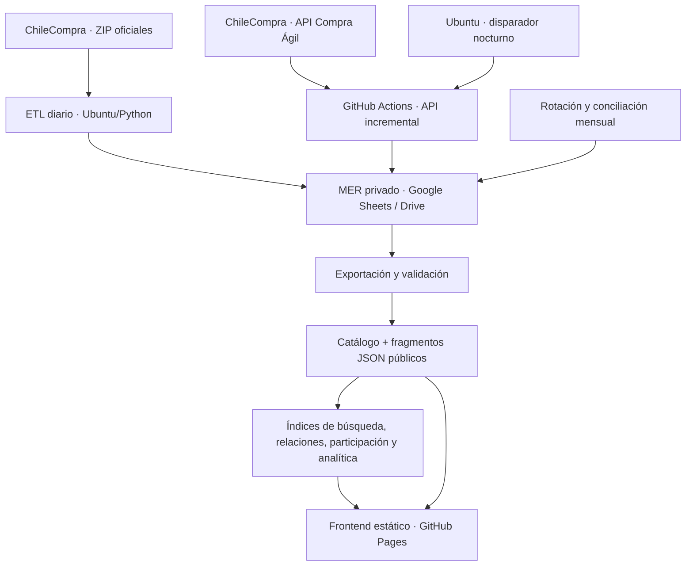

# Observatorio de Inteligencia de Mercado Público · Chile

**Una implementación abierta de referencia para explorar, relacionar y analizar información de contratación pública.**

[**Abrir plataforma en funcionamiento**](https://juliopez.github.io/MercadoPublico-Inteligencia/) · [Guía de instalación](docs/INSTALACION.md) · [Arquitectura y UML de despliegue](docs/ARQUITECTURA.md) · [Modelo de datos](docs/MODELO_DATOS.md)

> **Estado (6 de noviembre de 2026):** el frontend V2 es la única versión operativa. La ingestión diaria, la API incremental de Compra Ágil y la actualización de índices cuentan con ejecuciones satisfactorias. La rotación octubre→noviembre fue comprobada; **el siguiente cambio mensual y la conciliación histórica integral desatendida siguen pendientes de validación**. Los datos públicos tienen cobertura parcial y cambiante; consultar siempre el [catálogo vigente](frontend-v2/data/catalogo-publico.json).

## ¿Qué problema resuelve?

La información de Mercado Público se distribuye entre distintas fuentes, períodos y modalidades. Este proyecto construye una **vista consultable** de procesos, ofertas, resultados y órdenes de compra, con vínculos por código, perfiles históricos y análisis de actividad. Permite estudiar registros publicados **sin interpretar una oferta o selección como adjudicación jurídica ni un monto informado como pago efectuado**.

El repositorio ofrece una **implementación de referencia**, no un servicio oficial de ChileCompra. El frontend público se alimenta de archivos JSON derivados; las hojas MER y credenciales de operación son privadas.

## Explorar la plataforma: seis secciones

| Sección | Para qué sirve |
|---|---|
| **01 · Panorama del mercado** | Evolución mensual, modalidades, organismos compradores, montos informados y filtros temáticos |
| **02 · Explorar procesos y registros** | Búsqueda transversal por código o texto, filtros, resultados progresivos y exportación |
| **03 · Detalle del registro** | Ficha, campos oficiales disponibles y relaciones entre procesos, ofertas, resultados y OC |
| **04 · Analizar participantes** | Participación histórica de empresas oferentes y organismos compradores |
| **05 · Comparar proveedores** | Comparación de hasta tres empresas a partir de períodos publicados |
| **06 · Mis registros guardados** | Registros favoritos conservados localmente en el navegador |

Las consultas extensas presentan indicadores de avance. Los resultados y perfiles se limitan a los períodos **efectivamente publicados**; nombres normalizados no sustituyen la identificación por RUT.

## Inicio rápido: clonar y visualizar

Necesitas **Git, Python 3 y un navegador moderno**. No hace falta acceder a Google Sheets ni configurar la API para explorar la copia pública del frontend.

```bash
git clone https://github.com/juliopez/MercadoPublico-Inteligencia.git
cd MercadoPublico-Inteligencia
python3 -m http.server 8000
```

Abre **http://localhost:8000/** y prueba una búsqueda y el detalle de un proceso. El servidor HTTP es necesario para cargar los JSON mediante `fetch`. Este es un **modo de exploración**, no la instalación completa de los servicios de actualización. Consulta [instalación por niveles y verificaciones](docs/INSTALACION.md).

## Arquitectura: del origen a la consulta



La aplicación separa **ingestión, almacenamiento, publicación y presentación**. El navegador nunca necesita consultar las hojas privadas.

**Diagramas técnicos:** [arquitectura de componentes y UML de despliegue](docs/ARQUITECTURA.md) · [modelo entidad–relación y diccionario](docs/MODELO_DATOS.md).

## Modelo de datos: seis tablas internas, cuatro entidades públicas

El **MER privado** utiliza seis tablas por período:

- `Procesos`, `Ofertas`, `Resultados`, `OrdenesCompra`: registros de actividad.
- `Proveedores` y `VinculosCOT_OC`: identidad y relaciones de apoyo.

La **capa pública** expone cuatro entidades de consulta y artefactos derivados (índices, perfiles, participación y analítica). La clave de proceso vincula registros cuando la fuente lo permite, pero **no constituye por sí sola evidencia de adjudicación**. El esquema completo se define en el código del importador y se explica en [MODELO_DATOS.md](docs/MODELO_DATOS.md), con un diagrama ER renderizable.

## Cómo desplegar una instancia propia

| Nivel | Objetivo | Guía |
|---|---|---|
| **1. Explorar** | Servir el frontend y sus JSON públicos localmente | [Instalación](docs/INSTALACION.md) |
| **2. Adaptar** | Crear almacenamiento propio y exportar datos con los mismos contratos | [Configuración](docs/CONFIGURACION.md) · [Modelo de datos](docs/MODELO_DATOS.md) |
| **3. Automatizar** | Configurar tareas, secretos, reintentos, publicación y supervisión | [Automatización](docs/AUTOMATIZACION.md) · [Operación](docs/OPERACION.md) |

**Portabilidad:** Google Sheets puede reemplazarse por una base SQL; GitHub Actions, por otro orquestador; GitHub Pages, por otro servidor estático. **Estas alternativas son propuestas de adaptación, no conectores implementados o certificados.** Los scripts actuales contienen dependencias específicas de la infraestructura de referencia. Consulta [ADAPTACION.md](docs/ADAPTACION.md).

**No reutilices identificadores de Google Drive/Sheets, tokens ni credenciales de la instalación original.** Crea tus propios recursos y prueba la publicación en un ambiente aislado.

## Operación desatendida: qué está comprobado y qué falta

| Proceso | Implementación de referencia | Estado de validación |
|---|---|---|
| ETL licitaciones y OC | Ubuntu, 16:00 hora de Chile | Ejecuciones operativas verificadas |
| API Compra Ágil | Disparador Ubuntu 22:05 → GitHub Actions; lotes de 400 | Ejecuciones verificadas |
| Rotación del mes operativo | Timer independiente | Octubre→noviembre comprobado; siguiente ciclo pendiente |
| Conciliación histórica | Fuentes oficiales del mes vencido, timer independiente | **Primera ejecución integral desatendida pendiente** |
| Índices y participación | GitHub Actions activado por publicación de datos | Implementado y con ejecuciones satisfactorias |

**Importante:** que una tarea termine con `success` no demuestra que los datos estén completos. Verificar cobertura, conteos, metadatos, fragmentos y publicación. La [política de protección de los cuatro procesos](docs/POLITICA_PROTECCION_CUATRO_PROCESOS.md) impide cambios accidentales en las cadenas productivas.

## Estructura del repositorio

```text
frontend-v2/       Aplicación web y datos públicos fragmentados
scripts/           Importadores, ETL, exportación, índices y validaciones
config/            Configuración de referencia (no copiar identificadores)
.github/workflows/ Automatización y pruebas en GitHub Actions
tests/             Pruebas automatizadas
docs/              Guías, arquitectura, runbooks y evidencia histórica
historico/v1/      Prueba de concepto archivada, no operativa
index.html         Entrada de la plataforma pública
```

## Validación, límites y contribuciones

- **Cobertura:** períodos, fuentes y cantidades deben leerse del [catálogo público](frontend-v2/data/catalogo-publico.json), no de cifras estáticas en el README.
- **Interpretación:** distinguir presupuestos, montos ofertados, montos seleccionados, adjudicaciones informadas y OC. No inferir pagos.
- **Identidad:** nombres de empresas normalizados pueden corresponder a variantes legales; comprobar RUT cuando esté disponible.
- **Pruebas:** antes de publicar, validar sintaxis, contratos, índices, conteos, búsquedas y navegación. La operación mensual requiere una prueba integral adicional.
- **Cambios:** proponer modificaciones acotadas, documentar compatibilidad y no alterar ETL, API o temporizadores productivos sin pruebas y autorización.

## Continuidad operativa para nuevas auditorías

**[Abrir punto de recuperación operativa](docs/continuidad/README.md).** Incluye estado actual, inventario de cron y Actions, auditoría, incidencias y cambios; permite retomar rotación, conciliación, publicación e índices en otra conversación sin alterar procesos protegidos.

## Documentación de referencia

**Para empezar:** [Instalación](docs/INSTALACION.md) · [Arquitectura y despliegue UML](docs/ARQUITECTURA.md) · [Modelo de datos](docs/MODELO_DATOS.md) · [Configuración](docs/CONFIGURACION.md) · [Adaptación tecnológica](docs/ADAPTACION.md) · [Automatización](docs/AUTOMATIZACION.md) · [Operación](docs/OPERACION.md).

**Para profundizar:** [Mapa de mantenimiento de GitHub Actions](docs/GITHUB_ACTIONS_MANTENIMIENTO.md) · [Manual funcional del frontend](frontend-v2/README.md) · [Índice documental completo](docs/INDICE_DOCUMENTACION.md) · [Decisiones y restricciones](docs/DECISIONES_TECNICAS.md) · [Política de protección](docs/POLITICA_PROTECCION_CUATRO_PROCESOS.md).

Los documentos operativos fechados se conservan como **evidencia histórica** y pueden describir estados ya superados. Para conocer el comportamiento vigente, contrastar documentación, código y ejecuciones reales.
