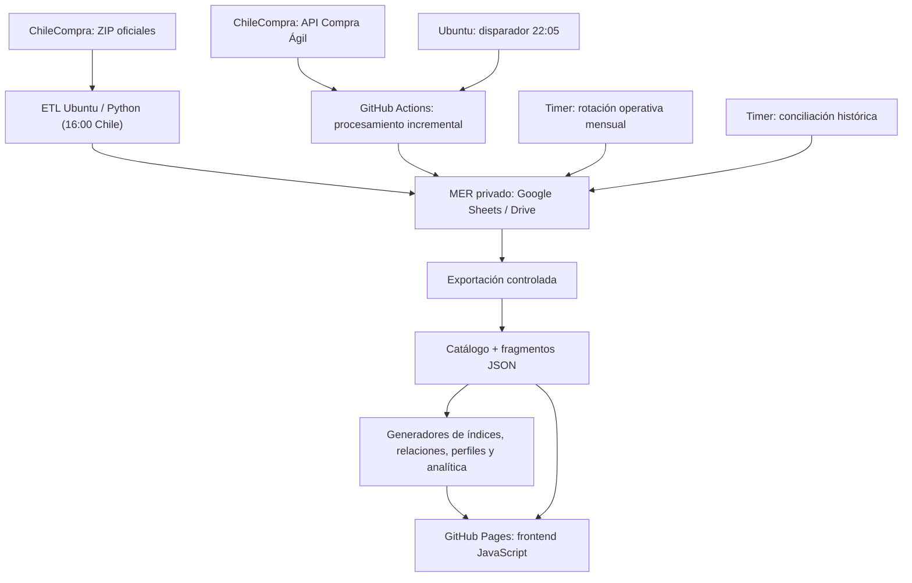
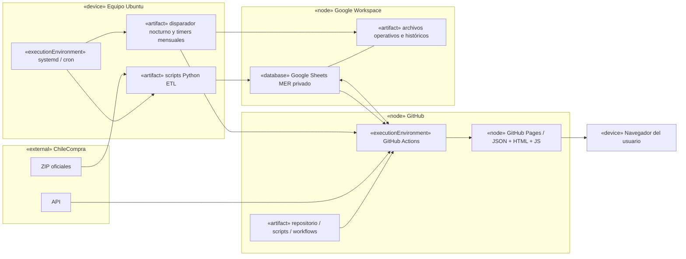

# Arquitectura y despliegue — implementación de referencia

La solución desacopla **captura**, **consolidación**, **publicación** y **consulta**. La implementación actual usa Ubuntu, Python, Google Sheets/Drive, GitHub Actions y GitHub Pages. La elección de proveedores no constituye un requisito conceptual del Observatorio.

## Vista de componentes

## Diagrama UML de despliegue (notación de nodos)

*Diagrama lógico de despliegue: muestra responsabilidades y conexiones principales, no todos los scripts, credenciales o rutas de red. El disparador nocturno en Ubuntu activa GitHub Actions; la publicación de datos también se realiza mediante workflows.*

## Procesos automatizados y nivel de evidencia

| Proceso | Activación en esta instalación | Evidencia y límite |
|---|---|---|
| ETL licitaciones y OC | Ubuntu, 16:00 Chile | Operación diaria comprobada |
| API Compra Ágil | Ubuntu 22:05 → GitHub Actions, lotes de 400 | Ejecuciones comprobadas; no alterar tasa ni reintentos sin evaluación |
| Rotación mensual | Timer local | Rotación octubre→noviembre comprobada; próximo ciclo sin validar |
| Conciliación mes vencido | Timer y fuentes oficiales del mes cerrado | Ejecución integral desatendida pendiente de validación |
| Índices de participación | GitHub Actions por cambios en catálogo/fragmentos | Regeneración automática implementada y ejecuciones exitosas |

Las ventanas y reglas reales se describen en [inventario de procesos](POLITICA_PROTECCION_CUATRO_PROCESOS.md); esta tabla **no** sustituye la verificación de timers en una instalación nueva.

## Interfaces sustituibles

| Componente | Contrato que debe preservarse | Alternativa ilustrativa, no probada aquí |
|---|---|---|
| MER privado | Seis entidades, período, identidad y trazabilidad | PostgreSQL, MySQL |
| Orquestación | Idempotencia, reintentos, checkpoint, bloqueo de escritura | Airflow, GitLab CI |
| Publicación | Catálogo, rutas relativas y fragmentos JSON consistentes | S3 + CDN, Nginx |
| Frontend | HTTP estático para `frontend-v2/` y sus datos | Cualquier servidor estático |
| Captura | Fuentes oficiales, controles de esquema y límites API | Otro adaptador de datos públicos |

**Seguridad:** secretos solo en Ubuntu/GitHub Secrets y cuentas de servicio; nunca en JSON públicos ni en el navegador. Para despliegues propios, crear identificadores y credenciales propios y verificar permisos mínimos.
