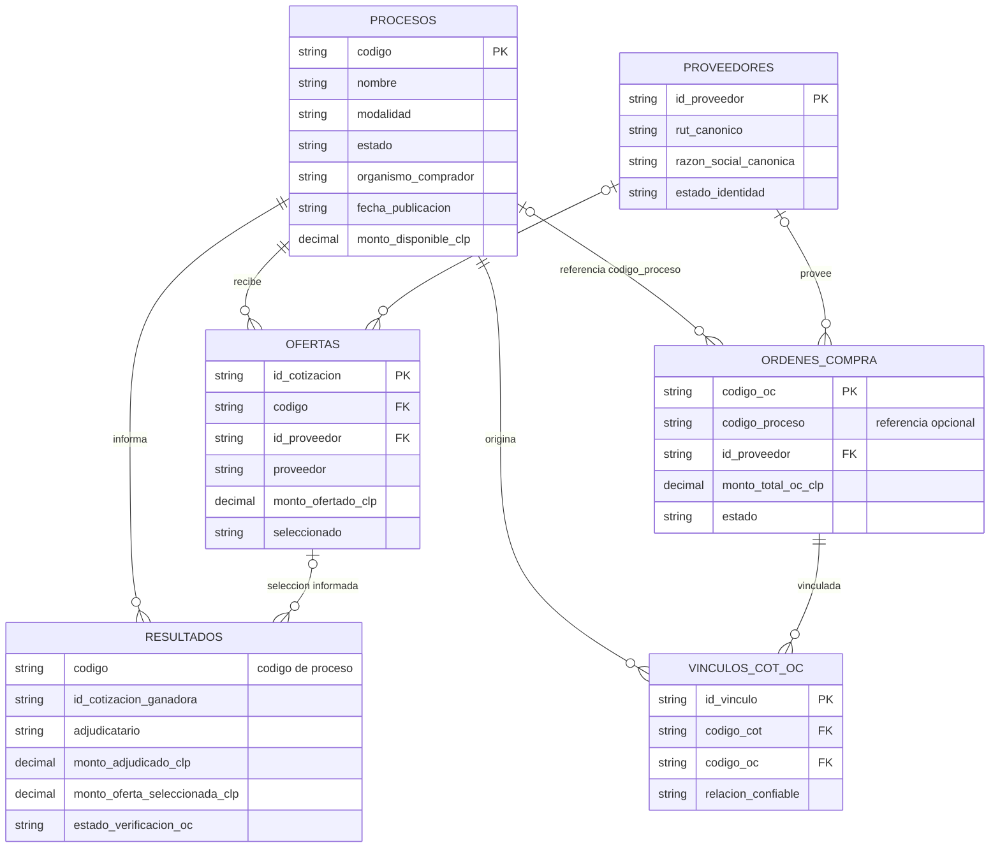
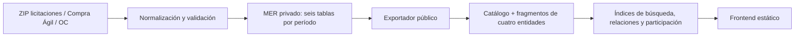

# Modelo de datos — Observatorio de Mercado Público

> **Referencia verificable:** `SCHEMA` en [`scripts/importador_historicos_v2.py`](../scripts/importador_historicos_v2.py). Este documento representa el **modelo lógico de intercambio MER v2**, no un DDL SQL instalado. Las relaciones son asociaciones de negocio y pueden estar incompletas por fuente y período.

## 1. Dos capas distintas

- **MER privado:** seis tablas por período en Google Sheets: `Procesos`, `Ofertas`, `Resultados`, `OrdenesCompra`, `Proveedores` y `VinculosCOT_OC`. Se utilizan para consolidar, auditar y vincular fuentes.
- **Capa pública:** cuatro entidades de consulta (`procesos`, `ofertas`, `resultados`, `ordenescompra`) y artefactos derivados (catálogo, fragmentos, índices, participación, perfiles, analítica). Los nombres y estructuras de los JSON públicos **no son equivalentes** a tablas SQL.

## 2. Diagrama entidad–relación lógico

**Nota de cardinalidad:** las conexiones representan asociaciones lógicas posibles, no restricciones de integridad referencial impuestas por Google Sheets. Puede haber procesos sin ofertas, OC sin código de proceso y resultados sin adjudicación verificada. Un mismo código puede aparecer en distintas fotografías mensuales; no asumir unicidad transversal a períodos.

## 3. Diccionario resumido y claves de asociación

| Entidad | Identificador de referencia | Vínculos relevantes | Precaución |
|---|---|---|---|
| Procesos | `codigo` | Ofertas y Resultados por `codigo`; OC por `codigo_proceso` | Identificar también el período y la modalidad |
| Ofertas | `id_cotizacion` | `codigo` → Procesos; `id_proveedor` → Proveedores | Oferta no equivale a adjudicación |
| Resultados | `codigo` | `id_cotizacion_ganadora` cuando existe | `monto_oferta_seleccionada_clp` no equivale a `monto_adjudicado_clp` |
| OrdenesCompra | `codigo_oc` | `codigo_proceso`, `id_proveedor` | OC no equivale necesariamente a pago |
| Proveedores | `id_proveedor` | Ofertas y OC | Identidad sin RUT contrastado puede ser provisional |
| VinculosCOT_OC | `id_vinculo` | `codigo_cot`, `codigo_oc` | Respetar `relacion_confiable` y procedencia |

El listado **completo y exacto de columnas** se mantiene en `SCHEMA` del importador; no duplicar una versión que pueda quedar obsoleta.

## 4. Transformación y publicación

El catálogo `frontend-v2/data/catalogo-publico.json` declara períodos, conteos y rutas de fragmentos. Los índices derivados deben corresponder a la **misma publicación**; el navegador no debe acceder a credenciales ni hojas privadas.

## 5. Adaptación a otra base de datos

Al usar PostgreSQL, MySQL u otro motor, definir claves compuestas que incluyan `periodo` cuando sea necesario, índices sobre códigos de proceso/OC y claves de proveedor, reglas de deduplicación por fuente y trazabilidad de carga. Esto es una **recomendación de diseño**, no un esquema SQL implementado en este repositorio.

Ver también [especificación de vínculos](Especificacion_Proveedores_Vinculos_COT_OC.md) y [diagrama MER original](MER_propuesto.mmd).
